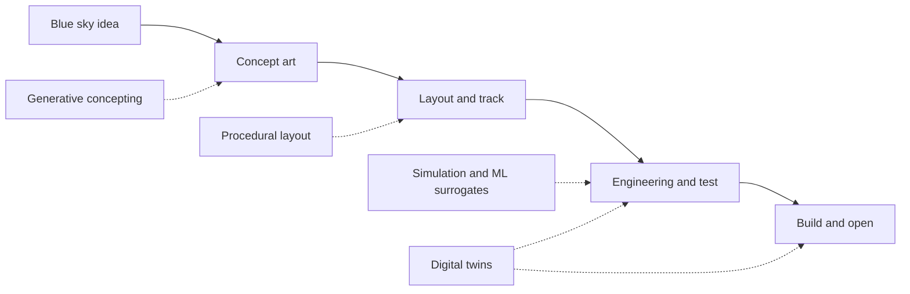

"AI in design" is an umbrella for four things that are easy to confuse. Generative concepting uses image and text models to produce many early options fast. Procedural layout uses optimization to shape a track or a land under constraints. Simulation and surrogates replace slow physics runs with fast learned approximations. Digital twins keep a live model of an attraction that is fed by real data.

The honest status in 2026: Disney told shareholders it uses AI-powered digital twins and simulation tools to design and stress-test new attractions, including for its Abu Dhabi park, and it has given its J.A.R.V.I.S. tool to more than 2,000 Imagineers. What those tools decide, and what remains an artist's call, is not public. Treat this land as a map of techniques, not a claim that any park is designed by machine.

The techniques plug into the ordinary [concept phase](../design-process/concept-phase.md), [previs](../design-process/previs.md) and [design reviews](../design-process/design-reviews-and-gates.md). They change speed, not the need for [art direction](../design-process/art-direction.md). Confidence is medium because deployment depth inside studios is undisclosed.

## Explore further
- `disney-q3-fy2026-shareholder-letter` — The Walt Disney Company Q3 FY2026 Shareholder Letter
- `adweek-disney-adobe-firefly` — Disney and Adobe Transform Theme Park Design With AI
- `blooloop-disney-ai-investment-2026` — Disney reports strong parks growth as AI investment accelerates
