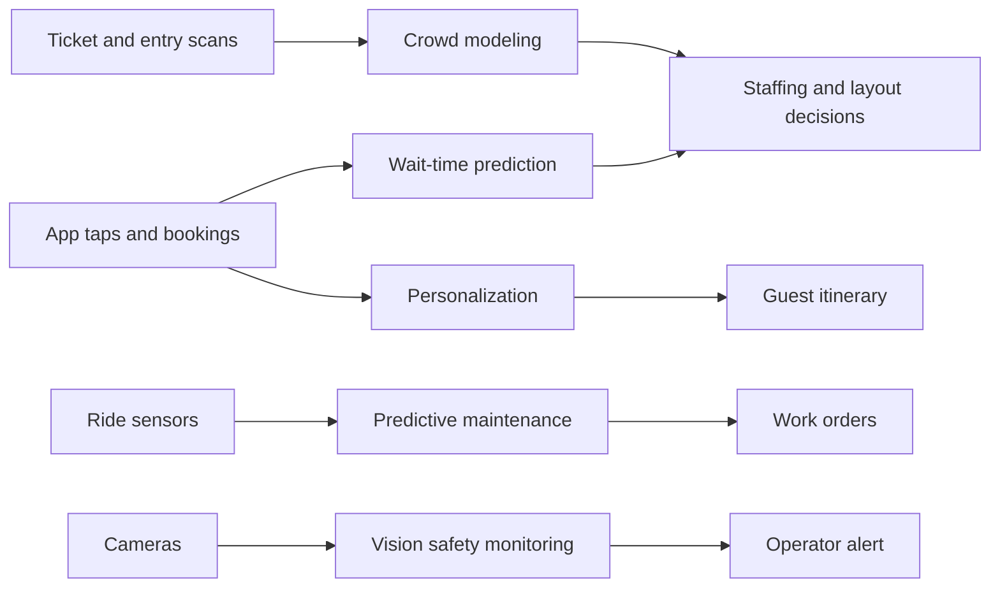

Operations is where AI in parks is most deployed, because the data already exists. Ticket scans, app taps, ride sensors and cameras produce streams that models can turn into forecasts and alerts. Five uses dominate this land. Crowd modeling simulates people moving through space. Wait-time prediction forecasts queues from history. Predictive maintenance listens to vibration and temperature. Personalization builds itineraries. Vision safety monitoring watches load platforms.

Deployment status varies a lot. Posted-wait forecasting is a mature commercial service; TouringPlans has validated its crowd index against observed waits daily since the 2010s. Sensor-based condition monitoring is sold today and was showcased by Vekoma and DMT at IAAPA Expo Europe 2025. Camera-based restraint checks are mostly patents. Keep those distinctions, because the people on the platform, the [ride operations staff](../operations-business/ride-operations-staffing.md), still carry the responsibility.

These tools support the ordinary [park operations](../operations-business/park-operations.md) loop, from [crowd management](../operations-business/crowd-management.md) to [preventive maintenance](../operations-business/preventive-maintenance.md), and they raise [data privacy](../ai-future/data-privacy.md) questions whenever a guest becomes a data point.

## Explore further
- `iaapa-funworld-ride-condition-monitoring-2025` — Safety Corner: Amusement Ride Condition Monitoring
- `touringplans-evaluate-crowd-calendar-2015` — How We Evaluate Our Crowd Calendar
- `d23-disney-genie-2021` — Wish Granted! Disney Genie Service Will Plan Your Perfect Day
