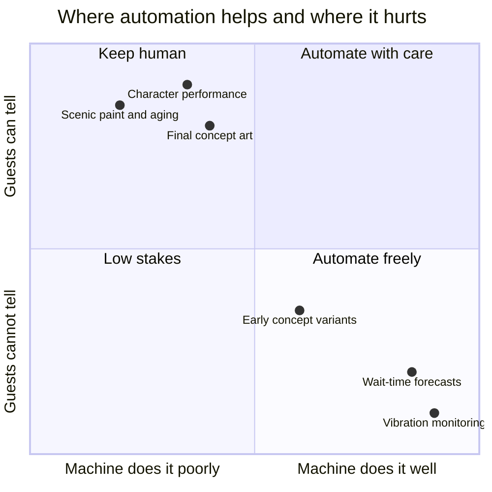

The craft question is not whether to use machines; parks have used them since the first lift chain. It is which steps carry meaning because a person made them. A forecast nobody sees can be automated without loss. A piece of concept art, a hand-aged wall, a puppeteered character: guests may not name the difference, but park makers insist they feel it, and the 2023 reaction to a Disney holiday image that looked machine-generated suggests audiences care.

The companies know this is contested ground. Disney created an Office of Technology Enablement in November 2024 to steer AI and XR adoption across film, TV and parks. In 2026 it announced custom Adobe generative models for Imagineering, and in its Q3 FY2026 letter CEO Josh D'Amaro framed AI as serving a process that stays "human-centered, artist-driven, and creator-led." Whether practice matches the framing is not yet visible from outside, which is why this card is medium confidence.

A working rule for designers: automate the parts that are costly, invisible and verifiable; protect the parts where [concept art](../design-process/concept-art.md), [scenic painting](../design-process/scenic-painting.md) and [figure programming](../show-technology/figure-programming.md) are the product. That protects [creative roles](../careers/creative-roles.md) and, more selfishly, the archive future models would learn from.

## Explore further
- `attractions-magazine-disney-ai-art-2023` — Is it OK for a company like Disney to use AI art?
- `blooloop-disney-ote-2024` — Disney forms new business unit to explore use of AI and emerging technologies
- `blooloop-disney-ai-investment-2026` — Disney reports strong parks growth as AI investment accelerates
- `adweek-disney-adobe-firefly` — Disney and Adobe Transform Theme Park Design With AI
