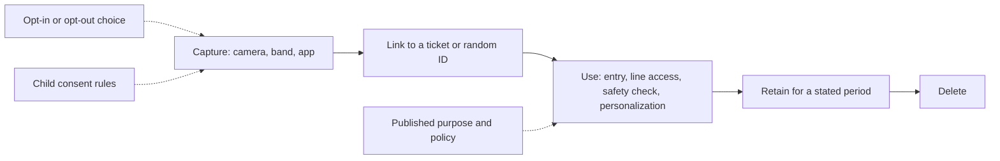

A park already knows a lot about you: where your ticket scanned, what your band tapped, which ride you reserved. Facial recognition changes the feel of that, because a face cannot be left at home. Two real cases set the terms. In March 2021 Walt Disney World tested face entry at Magic Kingdom in a clearly marked opt-in lane: a camera linked each face to a random number attached to the ticket, children needed an adult, and photos were to be deleted after 30 days. Disney later dropped the scanners after guest feedback. Universal Orlando tested "Photo Validation" at Islands of Adventure in 2023 and now uses it at Epic Universe entry portals and some attractions; guests can opt out, and adults who do must show photo ID to prove the ticket is theirs.

The pattern that reduces friction is boring and important: a plain purpose, a short retention period, a visible choice, and no silent reuse. The same questions apply to the ride-platform cameras in Disney's 2026 restraint-check patent filing and to [crowd analytics](../operations-business/crowd-analytics.md) feeds. For designers, privacy is a [trust](../human-factors/risk-perception-and-trust.md) budget: [wearables and identity](../operations-business/wearables-and-identity.md) systems spend it on convenience, and [guest research](../operations-business/guest-research.md) has to earn it back.

## Explore further
- `orlando-weekly-disney-facial-recognition-2021` — Walt Disney World tests facial recognition technology at park entrances
- `attractions-magazine-universal-photo-validation-2026` — Is Universal Orlando using facial recognition? Photo validation explained
- `imveurope-disney-restraint-vision-patent` — Disney patents machine vision AI to reduce waiting times
