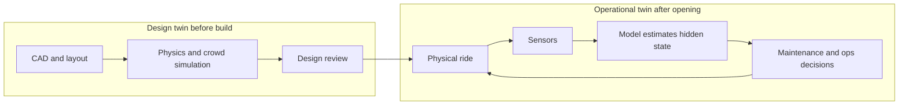

A digital twin is a living model of a specific physical thing, kept in step with it by data. Two different twins share the name. A design twin exists before anything is built: a simulation used to test throughput, sightlines or loads. An operational twin runs after opening: sensors on the ride stream into a model that estimates the state of parts you cannot see.

The clearest small example is Siemens' 2025 Simcenter Amesim model of an Oktoberfest Ferris wheel: CAD imported for mass and inertia, an electric motor and gearbox, a state-chart controller, and a design-of-experiments to pick rotation speed and loading strategy. Scale that up and you get what Disney described to shareholders in August 2026: AI-powered digital twins used to design and stress-test new attractions.

Operational twins pair with [predictive maintenance](../ai-future/predictive-maintenance.md) and the data habits behind [downtime and availability](../operations-business/downtime-and-availability.md). They also tighten [testing and commissioning](../design-process/testing-and-commissioning.md), because a commissioned ride can be compared with its own model. Vendor case studies often blur marketing and measurement, so confidence is medium. A twin is only as good as its [sensors and switches](../ride-engineering/sensors-and-switches.md).

## Explore further
- `siemens-simcenter-ferris-wheel-2025` — Simulating fun: Exploring the Oktoberfest ferris wheel with Simcenter Amesim
- `disney-q3-fy2026-shareholder-letter` — The Walt Disney Company Q3 FY2026 Shareholder Letter
- `iaapa-funworld-ride-condition-monitoring-2025` — Safety Corner: Amusement Ride Condition Monitoring
