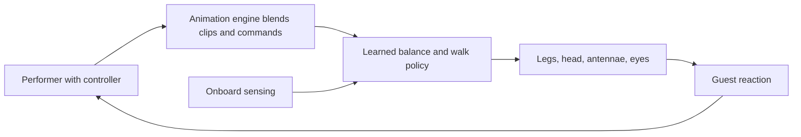

A free-roaming character robot is a show figure with no tether, no track and no fixed base. It has to balance, walk on real paving, be shoved by a toddler and still look like the character. Disney's answer splits the job: a performer with a controller decides what the character feels and where it goes, an animation engine blends that into motion targets, and a reinforcement-learned policy runs the legs. The 2024 Robotics: Science and Systems paper describes a mostly 3D-printed biped with a four-axis head and five-axis legs, trained in hours on one PC.

Deployment is real. After a one-day playtest in 2023, the BD-X droids appeared daily at Disneyland's Black Spire Outpost from April 5 to June 2, 2024. A walking Olaf, whose legs hide under a foam skirt so the snowball feet seem to slide, debuted at Disneyland Paris on March 29, 2026, trained to balance on a moving boat. Olaf's voice and high-level choices still come from humans.

For designers these are [untethered figures](../show-technology/untethered-figures.md) that must share scenes with [cast role-play](../story-experience/cast-role-play.md), can read attention the way the 2020 robot-gaze bust did, and trade on [surprise and delight](../human-factors/surprise-and-delight.md) while avoiding the [uncanny valley](../human-factors/uncanny-valley.md).

## Explore further
- `laughingplace-bdx-droids-2024` — BD-X Droids to Make Daily Appearances at Disneyland's Galaxy's Edge
- `attractions-magazine-robotic-olaf-2026` — How Imagineers brought a free-roaming robotic Olaf to life
- `blooloop-robotic-olaf-2026` — Disney Research unveils free-roaming robotic Olaf character
- `disney-research-robot-gaze-2020` — Realistic and Interactive Robot Gaze
