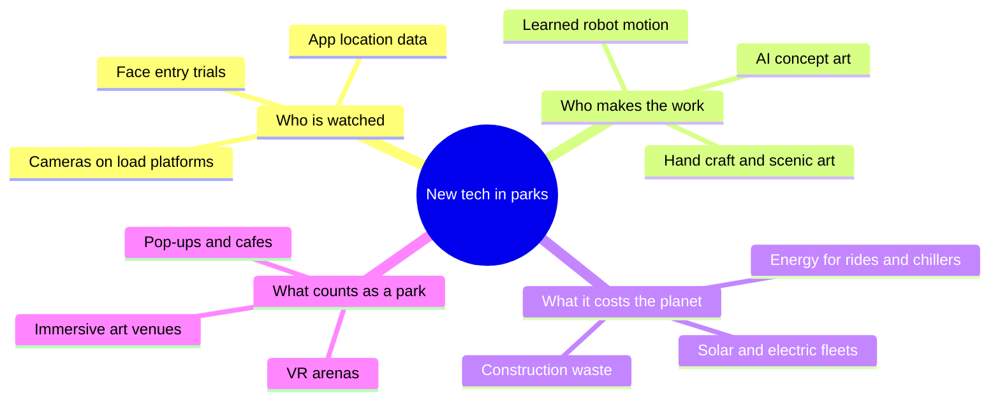

Every technique in this land arrives with a question the technique cannot answer. Face-matching entry is fast and makes some guests uneasy; Disney removed a 2021 trial after feedback, while Universal runs an opt-out version today. Generative tools speed concepting and threaten the people who built the archive they learn from. Learned robot motion delights children and quietly moves skill from puppeteers to simulation engineers. New rides draw power and pour concrete in a decade when Disney and Universal have published climate targets. And the word "park" is stretching to cover VR arenas, art warehouses and branded cafes.

This super-concept gathers four of those questions as its own cards. The thread between them is trust, the same [risk perception and trust](../human-factors/risk-perception-and-trust.md) that lets a guest hand over a child to a ride operator. Data policies, labor choices and energy decisions all spend or earn it. They also shape [industry structure](../operations-business/industry-structure.md), [creative roles](../careers/creative-roles.md) and the [safety culture](../safety-standards/safety-culture.md) that decides whether a clever system is allowed near a dispatch button.

## Explore further
- `orlando-weekly-disney-facial-recognition-2021` — Walt Disney World tests facial recognition technology at park entrances
- `disney-impact-environmental-goals` — Environmental Goals (Disney Impact)
- `licensing-international-lbe-definition-2023` — LBE Attracts New Definition
