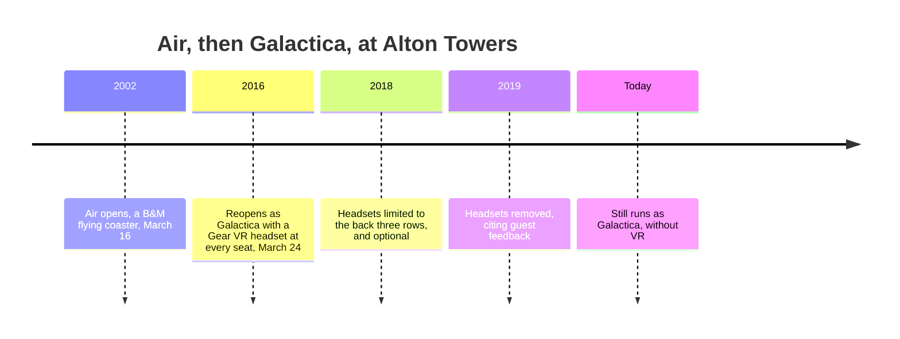

Galactica shows that a world first is not the same as a better ride. Alton Towers' flying coaster Air, built by Bolliger & Mabillard, opened in 2002. On 24 March 2016 it reopened as Galactica, with a Samsung Gear VR headset at every seat showing a flight through space; riders could opt out.

The cost showed up in operations. Handing out and fitting headsets adds time to every dispatch, and the ride's design capacity of 1,500 riders an hour was heavily reduced while VR ran, a problem of [throughput math](../operations-business/throughput-math.md), not of story. In 2018 headsets were limited to the back three rows and made optional; in 2019 they were removed, the park citing guest feedback. The coaster still runs as Galactica.

For [VR and AR in parks](../ai-future/vr-ar-in-parks.md) the lesson is that an overlay must earn back the minutes it adds and still please on the tenth ride; see [re-rideability](../story-experience/rerideability.md). Wendover Productions uses Galactica as its example of marketing that chases firsts. Removing an overlay can be its own [plussing](../story-experience/plussing.md).

## Explore further
- `wikipedia-galactica-roller-coaster` — Galactica (roller coaster)
- `wikipedia-alton-towers` — Alton Towers
- `wendover-how-to-design-a-theme-park` — How to Design a Theme Park (To Take Tons of Your Money)
