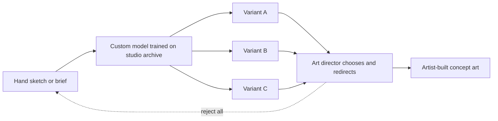

Generative concepting means using image or text models to turn a rough idea into many candidate pictures or descriptions quickly. The useful version is narrow: a model trained on a studio's own archive, steered by a sketch. In 2026 Walt Disney Imagineering said it would use Adobe Firefly Foundry to build custom models on Disney's design catalog and licensed material, including a sketch-to-image tool that turns hand-drawn roughs into rendered 2-D concept art. The stated aim is speed during pre-production, which can otherwise take years.

The craft question is real. Concept art is not only a picture; it is a decision about tone, scale and story. Models can flood a [mood board](../design-process/mood-boards.md) with options but cannot own the [design intent](../design-process/design-intent.md). The 2023 backlash over a Disney social-media image that looked machine-made shows how fast trust erodes, which feeds the wider [craft versus automation](../ai-future/craft-vs-automation.md) debate. Sensible practice: use generation in [blue sky](../design-process/blue-sky.md) for breadth, then hand the chosen direction to artists for [concept art](../design-process/concept-art.md) that can be built.

Confidence is medium because Disney has not said how widely the tools are used.

## Explore further
- `adweek-disney-adobe-firefly` — Disney and Adobe Transform Theme Park Design With AI
- `attractions-magazine-disney-ai-art-2023` — Is it OK for a company like Disney to use AI art?
- `blooloop-disney-ote-2024` — Disney forms new business unit to explore use of AI and emerging technologies
