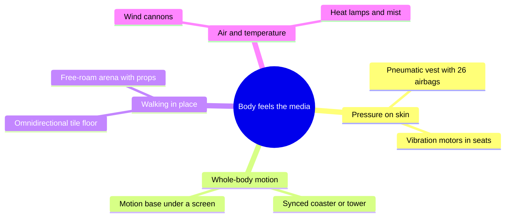

Haptics is the sense of touch and force. The oldest park haptics are wind, mist and the seat kick of a 4D theatre. The next generation tries to make the body feel a specific virtual event at the right instant. Disney Research's Force Jacket (2018) is the clearest example: a vest with 26 inflatable compartments, each pumped or dumped on cue, so a virtual snowball hits your chest with real pressure rather than a buzz. HoloTile (January 2024) attacks walking instead: hundreds of motorized tiles move under several people at once so they can stroll through a virtual world without leaving the floor.

The deployed end of the spectrum is familiar motion made smarter. VR Coaster syncs headsets to real coasters, drop towers and bumper cars so the vestibular system is told the truth while the eyes see fiction: the ride is the feedback device.

Status matters: the vest and the floor are research prototypes with no confirmed park installation. The principle is [multisensory integration](../human-factors/multisensory-integration.md): a cue the body feels makes the picture more believable, and a late or wrong cue breaks it, the same rule behind [motion cueing](../ride-systems/motion-cueing.md) and [wind, heat and scent effects](../show-technology/wind-heat-and-scent-effects.md). Touch sits with [proprioception](../human-factors/proprioception-and-haptics.md).

## Explore further
- `techcrunch-force-jacket-2018` — Disney's pneumatic 'Force Jacket' could be the key to awesome VR theme parks
- `blooloop-holotile-2024` — Disney unveils HoloTile floor technology
- `vr-coaster-mack-group` — VR Coaster: Virtual Reality for the leisure industry
