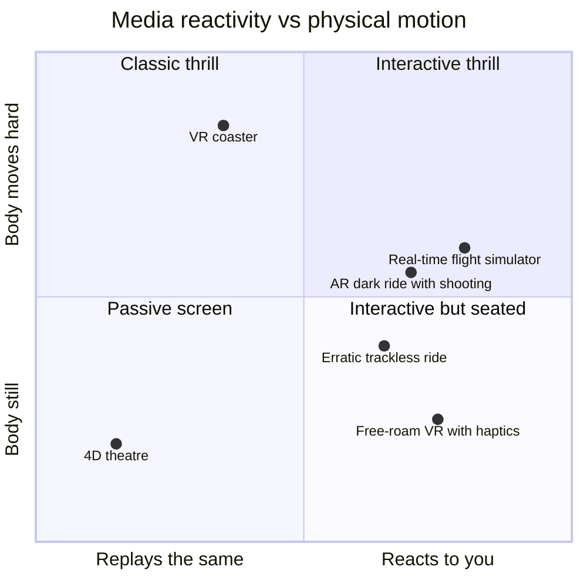

Immersive media is the part of show technology that stops being a film. A media dark ride of the 2000s played the same projected clip to every car. The four concepts under this heading change that in different ways. VR and AR put the picture on the rider's head. Real-time engines render the picture during the ride, so it can respond. Personalized and branching rides change route or story per vehicle. Haptics and next-generation motion let the body feel what the eyes see.

Deployment ranges widely. VR coasters have been commercial since Europa-Park's Alpenexpress in 2015. Game engines run Millennium Falcon: Smugglers Run, which stretches or shortens scenes to hit its load-station window. Walibi Belgium's Popcorn Revenge has routed trackless cars through different rooms since 2019. Research haptics such as Disney's Force Jacket and HoloTile floor have no confirmed park use.

The design tension is the old [screens versus sets](../show-technology/screens-vs-sets-debate.md) debate with new tools: media that reacts can deepen [presence](../human-factors/presence.md) or, badly done, strand guests inside a headset. The plumbing is the [media server and real-time engine](../show-technology/media-servers-and-real-time-engines.md) layer, and the physical half is still the [motion base](../ride-systems/motion-base.md).

## Explore further
- `vr-coaster-mack-group` — VR Coaster: Virtual Reality for the leisure industry
- `mobilesyrup-smugglers-run-unreal-2025` — How Epic's Unreal Engine powers a major Star Wars theme park ride
- `alterface-popcorn-revenge` — Popcorn Revenge, Walibi Belgium
