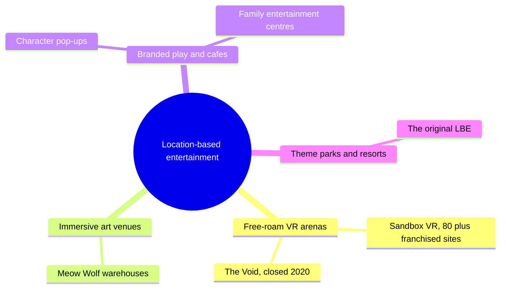

Location-based entertainment (LBE) is the industry's name for anything you must travel to and pay for: originally theme parks and resorts, now stretched to VR arenas, immersive art venues, escape rooms, branded cafes and pop-ups. Licensing International noted in 2023 that the term has become "almost everything and anything," which is exactly why designers should watch it: the craft of parks is being applied in small boxes with short tickets.

Two models show the range. Sandbox VR, founded in 2016, sells 30-minute free-roam VR sessions through franchised rooms; by March 2026 it reported more than 80 locations, five million lifetime players and $300 million in sales. Meow Wolf raised over $158 million in 2019 to scale its artist-built immersive warehouses from Santa Fe to Las Vegas and Denver. A cautionary case sits between them: The Void's Star Wars: Secrets of the Empire (2017) proved hyper-reality VR with physical sets, yet the company closed in 2020.

What transfers from parks is the hard part: [presence](../human-factors/presence.md) built from physical detail, [story rooms and walkthroughs](../story-experience/story-rooms-and-walkthroughs.md), and the throughput discipline of [indoor parks](../masterplanning/indoor-parks.md). What changes is economics: [IP licensing](../operations-business/ip-licensing-economics.md) at mall rents, shorter dwell, and a franchise logic that reshapes [industry structure](../operations-business/industry-structure.md).

## Explore further
- `licensing-international-lbe-definition-2023` — LBE Attracts New Definition
- `gamesbeat-sandbox-vr-2026` — Sandbox VR hits $300M in lifetime sales and grows to 80 locations
- `blooloop-meow-wolf-2019` — Meow Wolf raises more than $158m for ambitious expansion plans
- `techcrunch-void-secrets-of-the-empire-2017` — In 'Star Wars: Secrets of the Empire,' virtual reality finds a new hope
