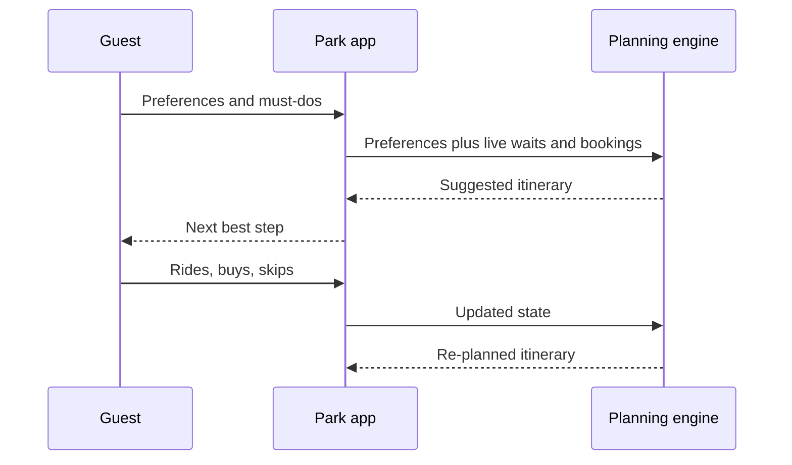

Personalization in a park means the system knows something about you and changes what it offers. The simplest version is a planner. Disney Genie, announced in August 2021, asks what kind of day a guest wants, builds an itinerary from those preferences and live conditions, and keeps rewriting it through the day. The paid layer, Genie+, was renamed Lightning Lane Multi Pass on July 24, 2024, when Walt Disney World also let guests pre-book up to seven days ahead (three for off-site guests).

A different flavor lives in the land itself. Super Nintendo World's Power-Up Band is a wristband linked to the app; tapping it on blocks and on the Mario Kart steering wheel logs coins and stamps, feeds team leaderboards, and unlocks a final boss challenge. Here personalization is a game state, not a schedule.

Both rely on [wearables and identity](../operations-business/wearables-and-identity.md) and sit on top of [virtual queues](../human-factors/virtual-queues.md) and [paid priority access](../human-factors/paid-priority-access.md). Designers should treat the app as [choice architecture](../human-factors/choice-architecture.md): a default itinerary steers crowds, and a confusing one adds [decision fatigue](../human-factors/decision-fatigue.md) to a day that was supposed to be simple.

## Explore further
- `d23-disney-genie-2021` — Wish Granted! Disney Genie Service Will Plan Your Perfect Day
- `nerdwallet-lightning-lane-multi-pass` — Disney Genie+ Is Now Called 'Lightning Lane Multi Pass'
- `attractions-magazine-power-up-bands-2023` — How do Power-Up Bands work in Super Nintendo World?
