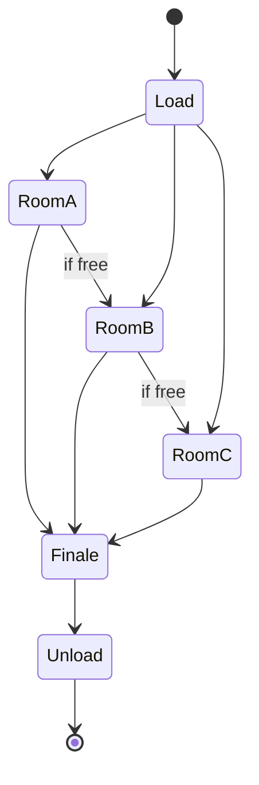

A classic dark ride is a sentence read the same way every time. A branching ride lets the order, the scenes or the outcome change. There are three honest levels, and "personalized" gets used for all of them. Level one is variation: Walibi Belgium's Popcorn Revenge (2019), built by Alterface with ETF trackless vehicles, sends six-seat cars through rooms in different orders on about 400 square metres, so repeat riders see a different show. Level two is reaction: Millennium Falcon: Smugglers Run renders live and changes outcomes based on how the crew flies. Level three is memory: Super Nintendo World's Power-Up Band carries coins and stamps between the land and the Mario Kart ride.

True per-guest narrative branching, where the story knows who you are, is still rare on big rides; most examples are score, route or difficulty. Hence medium confidence on the "personalized" promise; the examples are verified.

The costs are real. Branching trackless layouts complicate [throughput math](../operations-business/throughput-math.md) because rooms become shared resources. The creative question is [agency versus spectacle](../human-factors/agency-vs-spectacle.md): every choice handed to a rider is a beat the designer no longer controls, a tension familiar from [interactive narrative](../story-experience/interactive-narrative.md) and the [trackless ride](../ride-systems/trackless-ride.md) format.

## Explore further
- `alterface-popcorn-revenge` — Popcorn Revenge, Walibi Belgium (Alterface portfolio)
- `mobilesyrup-smugglers-run-unreal-2025` — How Epic's Unreal Engine powers a major Star Wars theme park ride
- `attractions-magazine-power-up-bands-2023` — How do Power-Up Bands work in Super Nintendo World?
