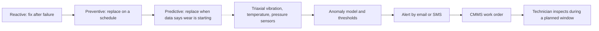

Predictive maintenance adds a listening layer on top of the inspection routine every park already runs. Small sensors on train bogies, drives or hydraulics record vibration, shock, temperature and pressure continuously. Software compares each day's signature against the component's own history and against limits, and raises a flag when a trend starts to drift, often days before a human check would catch it. That flag becomes a work order so the part is swapped in a planned window instead of mid-afternoon with a full queue.

IAAPA's Funworld described the industry's shift from reactive to preventive to predictive in December 2025, citing Vekoma fitting DMT sensors to coaster trains for Karls Erlebnis-Dorf in Germany, with data flowing into the park's Mobaro maintenance system. DMT's RideGuard uses a triaxial accelerometer and AI anomaly detection, and can correlate readings with weather. The vendors themselves stress that this sits alongside, not instead of, [inspections](../safety-standards/inspections.md) and the scheduled [preventive maintenance](../operations-business/preventive-maintenance.md) that standards require.

The payoff lands in [downtime and availability](../operations-business/downtime-and-availability.md) and in understanding [fatigue](../ride-engineering/fatigue.md) on real duty cycles rather than assumed ones. The risk is alert fatigue: a signal with no owner is noise.

## Explore further
- `iaapa-funworld-ride-condition-monitoring-2025` — Safety Corner: Amusement Ride Condition Monitoring
- `dmt-rideguard` — DMT RideGuard online ride condition monitoring
- `mobaro-predictive-maintenance` — From Ride Data to Action: How Predictive Maintenance Can Strengthen Park Operations
