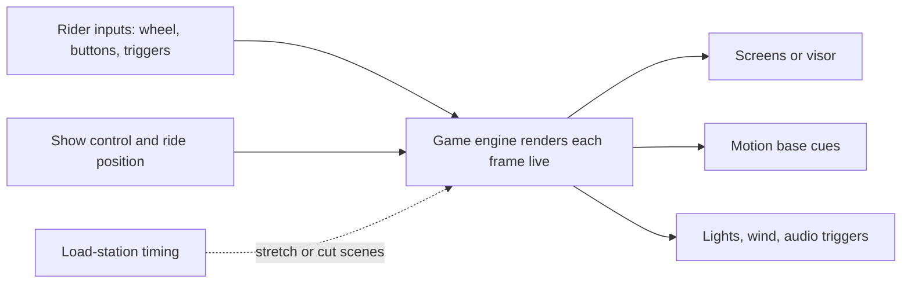

A pre-rendered ride film is finished before the first guest boards. A real-time engine, the same software that runs video games, draws every frame while the ride runs, so the picture can respond to what riders do and to what the ride system needs. Two consequences follow. Media can be interactive: steering, shooting, scoring. And media can be elastic: scenes can be lengthened or cut to fit the moment the vehicle must return.

Millennium Falcon: Smugglers Run is the reference case. Imagineering built it on a custom fork of Unreal Engine 4 with Epic and ILM; the system keeps recalculating when the cockpit will reach the load station and stretches or trims moments such as the hyperdrive repair so riders never sit through dead frames. A new Mandalorian mission uses Unreal Engine 5. An earlier example is Carowinds' Plants vs. Zombies 3Z Arena (2016), an Alterface and Pure Imagination theater where two audiences compete on synchronized screens.

In practice the engine sits on the [media server](../show-technology/media-servers-and-real-time-engines.md) layer, takes position from [show control](../show-technology/show-control-systems.md), and must stay frame-locked to the [motion base](../ride-systems/motion-base.md) for [ride-show synchronization](../show-technology/ride-show-synchronization.md). It is the enabling technology for any [interactive dark ride](../ride-systems/interactive-dark-ride.md) that wants more than a scoreboard.

## Explore further
- `mobilesyrup-smugglers-run-unreal-2025` — How Epic's Unreal Engine powers a major Star Wars theme park ride
- `fortune-carowinds-pvz-unreal-2016` — Electronic Arts Grows 'Plants vs. Zombies' Theme Park Game
