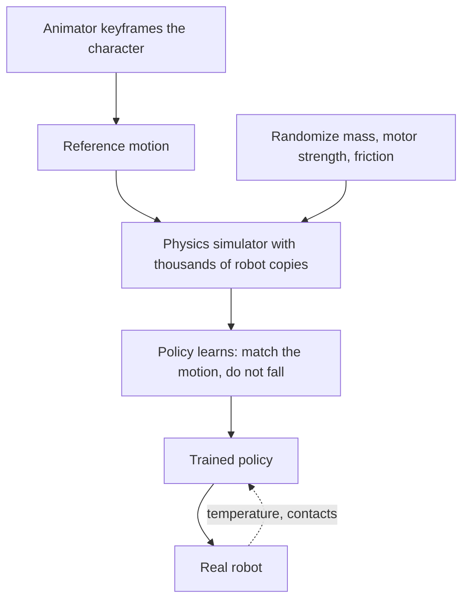

Classic [figure programming](../show-technology/figure-programming.md) records a motion and replays it; the figure never has to balance because it is bolted down. A walking character cannot replay. Reinforcement learning (RL) solves this by letting a controller practice in simulation. The animator supplies a reference motion. Thousands of simulated copies of the robot attempt it under randomized conditions, mass, motor strength, ground friction, and are rewarded for matching the animation while staying upright. The resulting policy is then run on real hardware. Disney Research reported training new behaviors in hours on one PC, and that randomization produced recovery moves nobody hand-programmed.

The Olaf paper from late 2025 shows how park reality shapes the rewards. Extra terms penalize loud foot impacts, because a character should not clatter. Motor temperatures are fed into the policy with rewards that keep them in bounds, because a foam-covered body overheats. Linkages pack the actuators inside a costume. The training stack, Newton with Disney's Kamino layer, is a collaboration with NVIDIA and Google DeepMind.

This is the method behind [free-roaming robots](../ai-future/free-roaming-robots.md). It reframes [figure actuation](../show-technology/figure-actuation.md) and [figure reliability](../show-technology/figure-reliability.md) as things you can shape in software, and it borrows the same sim-to-real idea as [ML surrogates](../ai-future/simulation-and-surrogates.md).

## Explore further
- `disney-research-bipedal-character-2024` — Design and Control of a Bipedal Robotic Character
- `arxiv-olaf-robotic-character-2025` — Olaf: Bringing an Animated Character to Life in the Physical World
- `ieee-spectrum-disney-bipedal-2023` — How Disney Packed Big Emotion Into a Little Robot
