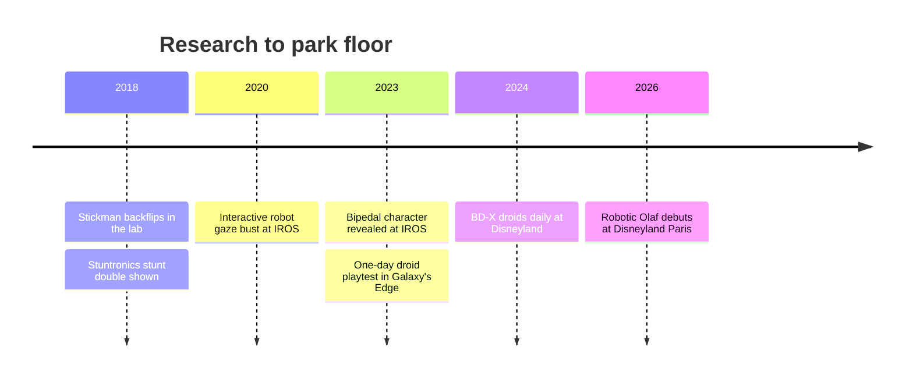

For sixty years the park character was an [Audio-Animatronics](../show-technology/audio-animatronics-history.md) figure: bolted down, fed by cables and hydraulics, replaying a fixed show. This land covers the newer family that leaves the base. Three strands matter. Free-roaming robots walk among guests and react to them. Reinforcement learning for figures is the method that teaches them to move in character without falling. Stuntronics are untethered figures that fly through the air and land on their marks.

What is deployed versus research is clear enough to state. The BD-X droids became a daily offering at Disneyland's Galaxy's Edge in spring 2024, and a free-walking Olaf debuted at Disneyland Paris on March 29, 2026. Stuntronics was shown in 2018 and remains a research platform with no announced park installation. An animatronic bust with lifelike gaze was a 2020 conference paper.

The design stakes are familiar from [untethered figures](../show-technology/untethered-figures.md): batteries, heat, falls and [figure reliability](../show-technology/figure-reliability.md) on a 12-hour day. The creative stakes are about the [uncanny valley](../human-factors/uncanny-valley.md) and about how a robot and a human [cast member](../story-experience/cast-role-play.md) share a scene.

## Explore further
- `disney-research-bipedal-character-2024` — Design and Control of a Bipedal Robotic Character
- `blooloop-stuntronics-2018` — Stuntronics: Disney creates robot stunt doubles for theme parks
- `attractions-magazine-robotic-olaf-2026` — How Imagineers brought a free-roaming robotic Olaf to life
