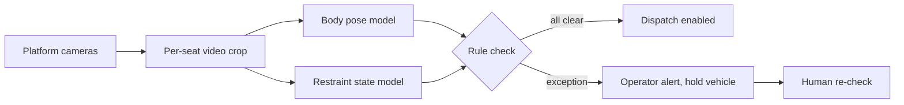

Vision safety monitoring uses cameras plus machine learning to watch what operators already check by hand: is each restraint closed and locked, is anyone sitting on a belt, has a rider loosened a bar after the check, is a hand outside the [reach envelope](../safety-standards/reach-envelope.md). The usual architecture crops each seat from continuous video, runs a pose model and a restraint-state model, compares the result against a rule, and either clears dispatch or raises an exception to the operator.

Status matters here. A granted 2024 US patent from an individual inventor claims camera analytics that flag a rider position against a rule. Trade press in 2026 reported that Walt Disney Imagineering has filed for AI vision that automates restraint checks. Neither is a confirmed, running system on a public ride, and no park has published accuracy figures. This card is low confidence for that reason: the filings are real, but deployment and performance are unverified.

If it arrives, it changes [dispatch procedures](../safety-standards/dispatch-procedures.md) and [operator training](../safety-standards/operator-training.md) rather than replacing them; [restraint design rules](../safety-standards/restraint-design-rules.md) still assume a human in the loop. It also puts cameras on every guest, a [data privacy](../ai-future/data-privacy.md) question before it is an engineering one.

## Explore further
- `google-patents-us12033417` — US12033417B2: Entertainment device safety system and related methods of use
- `imveurope-disney-restraint-vision-patent` — Disney patents machine vision AI to reduce waiting times
