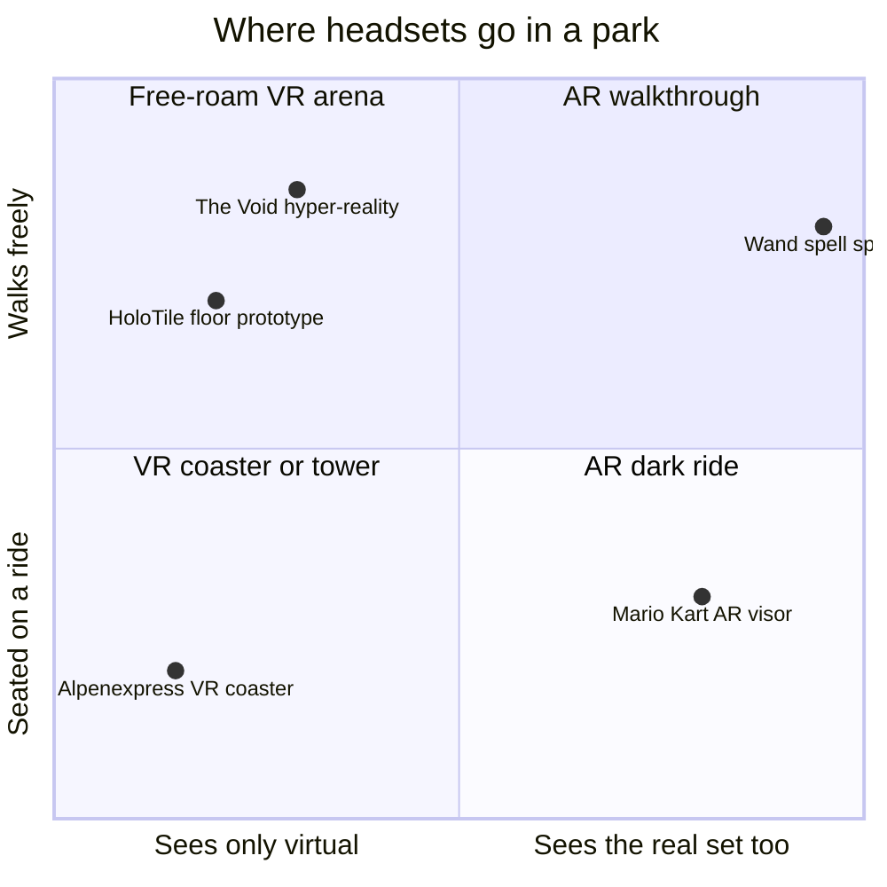

Virtual reality (VR) replaces what you see; augmented reality (AR) adds to it. Both reached parks in distinct formats. The VR coaster began with Europa-Park's Alpenexpress in September 2015: riders wear headsets on a 1984 mine train while sensors sync the film to the train's speed and position, so the stomach and the eyes agree. VR Coaster GmbH grew out of that project. The AR dark ride arrived with Mario Kart: Bowser's Challenge (Japan 2021, Hollywood 2023, Epic Universe 2025), where a visor overlays racing characters onto physical sets and riders aim shells by turning their heads. Free-roam VR with matching physical props was proven by The Void's Star Wars: Secrets of the Empire (December 2017), though the company closed in 2020. Disney's HoloTile floor, unveiled in January 2024, is a prototype for walking in place.

The costs are the same every time. Headsets must be fitted and cleaned, which hits [throughput math](../operations-business/throughput-math.md). Any lag between motion and image invites [motion sickness](../human-factors/motion-sickness.md) by the mechanism of [sensory conflict](../human-factors/sensory-conflict-theory.md). And a headset isolates: unlike a [dome screen](../show-technology/domes-and-wraparound-screens.md), it hides the friend next to you, so the best designs put something physical, a wheel or a wand, back in your hands.

## Explore further
- `blooloop-alpenexpress-vr-2015` — Europa-Park unveil revolutionary VR coaster: Alpenexpress VR-Ride
- `wikipedia-mario-kart-bowsers-challenge` — Mario Kart: Bowser's Challenge
- `techcrunch-void-secrets-of-the-empire-2017` — In 'Star Wars: Secrets of the Empire,' virtual reality finds a new hope
- `blooloop-holotile-2024` — Disney unveils HoloTile floor technology
