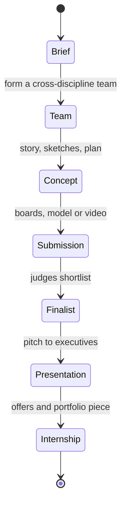

Studios use competitions to find interns. The best known is Imaginations, the Walt Disney Imagineering design competition Marty Sklar started in 1991. Hundreds of US students have presented to Imagineering executives; many became interns. Hong Kong Disneyland has run its own edition since 2011; the 2025 round drew 200 teams and more than 640 participants, the first with international universities, and the winners earned a three-month internship at WDI Hong Kong. Shanghai Disney Resort sponsors a version as well.

Engineers have the Ride Engineering Competition, where university teams get six months to design and build a working model attraction to a shared prompt, judged in Hershey, Pennsylvania in April 2026 with more than 370 students. The 2026 brief demanded a portable ride that tilts 45 degrees and can be rebuilt on site, which forces real [g-force](../ride-engineering/g-force-basics.md) and structural thinking.

Toronto Metropolitan University's Thrill Design Competition, run by Kathryn Woodcock since 2014, is an invitational timed to IAAPA Expo; challenges are revealed on arrival. For high schoolers, Ringling College runs a design competition with Universal Creative. Each entry is a compressed [blue sky](../design-process/blue-sky.md) exercise with real [concept art](../design-process/concept-art.md), so it doubles as a [portfolio](../careers/portfolio-building.md) chapter.

## Explore further
- `wdi-internships-imaginations` — WDI Internships and the Imaginations Design Competition
- `the-standard-imaginations-hong-kong` — Imaginations Hong Kong 2025
- `calpoly-ride-engineering-competition` — Ride Engineering Competition 2026
- `tmu-thrill-design-competition` — Thrill Design Competition
