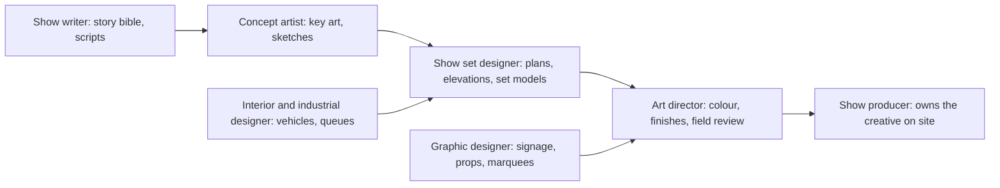

Creative roles decide what the ride is before anyone decides how to build it. Typical titles are concept artist or illustrator, show writer, show set designer, graphic designer, interior or industrial designer, art director and creative director. Universal Creative groups them in its Creative Studio alongside show and media producers.

What they make is concrete: a [story bible](../story-experience/story-bible.md), key [concept art](../design-process/concept-art.md), mood boards, show set drawings, prop lists and vehicle styling. Later they shift to [art direction](../design-process/art-direction.md) on site, checking paint, rockwork and lighting against the intent set in [blue sky](../design-process/blue-sky.md).

Tools are a mix of hand drawing, Photoshop-style painting, and 3D packages such as Blender, ZBrush and SketchUp or Rhino for show sets. The skill that still matters most is drawing to communicate. Former Imagineer Don Carson says the first question is whether you can draw and explain an idea; he got his interview with about 150 paintings of Disneyland details. Theme park veteran Tony Baxter is quoted advising candidates to be "very good at just one thing", while BRC's Bob Rogers prefers generalists. Either way, a [portfolio](../careers/portfolio-building.md) of finished, explained projects is the entry ticket.

## Explore further
- `inside-the-magic-don-carson` — Interview: How do I become an Imagineer? with Don Carson
- `themedattraction-how-to-become-designer` — How to become a Theme Park Designer
- `universal-creative-careers` — Universal Creative — Careers
