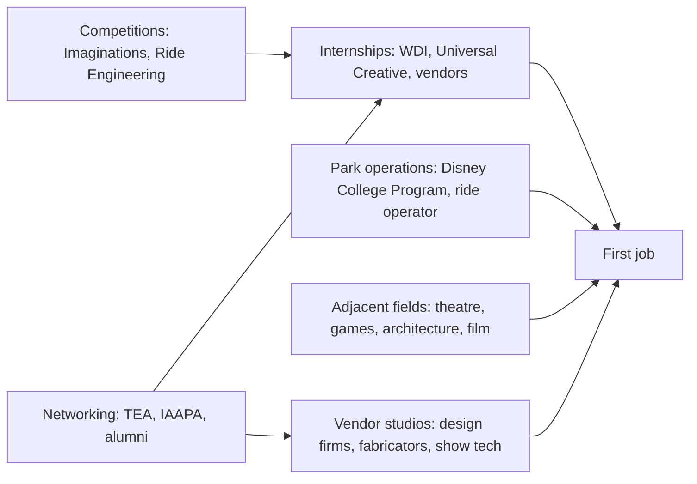

The front door is narrow. Walt Disney Imagineering offers paid internships to college students and recent graduates on real project assignments; Disney's US internships run three to six months, extendable to a year. Universal Creative posts internships whose application windows open three to four months before each semester. Competition finalists have an edge.

Side doors are wider. The Disney College Program puts enrolled US students into front-line roles at Walt Disney World; many designers started as ride operators, and that [operations](../operations-business/ride-operations-staffing.md) and [service culture](../operations-business/service-culture.md) experience is valued later. Adjacent industries are another route: theatre technicians move into show control, game developers into interactive media, architects into show set design.

Most jobs are not at Disney. Former Imagineer Brian Collins points students to Universal Creative, Legoland, SeaWorld and the Central Florida firms that support them; Merlin's studio is covered under [Merlin Magic Making](../history/merlin-magic-making.md) and Universal's under [Universal Creative](../history/universal-creative.md). Vendors hire more juniors than owners do.

Falcon's Creative Group staff describe the mechanics: ask people you know about openings, connect on LinkedIn beyond your city, attend TEA and IAAPA events, follow up, and accept an unglamorous role that gets you inside. Work is project-based, so expect to move between firms.

## Explore further
- `wdi-internships-imaginations` — WDI Internships and Imaginations
- `disney-careers-internships-us` — Disney Careers — Internships
- `universal-creative-careers` — Universal Creative — Careers
- `falcons-foot-in-the-door` — How to Get Your Foot in the Door at a Theme Park Design Company
