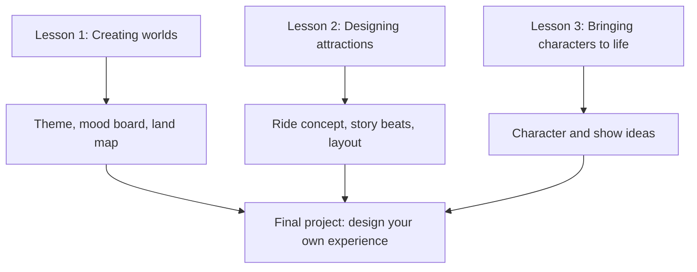

Imagineering in a Box is the closest thing to an official introductory course. Walt Disney Imagineering released it in March 2020 with Khan Academy and Pixar, free to anyone. It has three parts, world-building, attraction design and character development, each taking at least two hours, built from 32 videos in which Imagineers explain their work, plus case studies, interactive activities and an educator's guide for classrooms. It ends by asking you to design your own theme park experience.

The first lesson covers the difference between an amusement park and a theme park and leaves you with a theme, a [mood board](../design-process/mood-boards.md) and a map, which is a compact version of real [land design](../masterplanning/land-design.md). The second treats attraction design as story, physics and engineering together. The third covers characters and how they live in a space. Josh Gorin, a creative development executive at Imagineering, described the programme as free for everyone.

Use it actively. Write a short [story bible](../story-experience/story-bible.md) for your land, sketch the map, and treat the final project as a first [blue sky](../design-process/blue-sky.md) exercise you can later rework for a competition or portfolio. The course lives in Khan Academy's humanities section under storytelling.

## Explore further
- `khan-imagineering-in-a-box` — Imagineering in a Box (Khan Academy)
- `attractions-management-imagineering-in-a-box` — Launch coverage, Attractions Management
