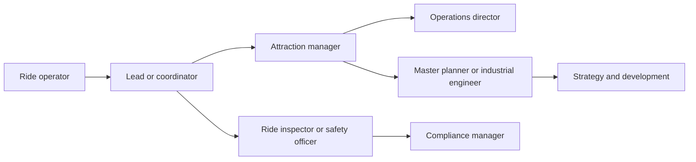

Planning and operations roles make attractions work for real crowds. On the planning side, master planners and industrial engineers build [capacity plans](../masterplanning/capacity-planning.md) around a [design day](../masterplanning/design-day.md), check [throughput math](../operations-business/throughput-math.md) for each ride and decide where queues, shops and restrooms go. On the operations side, ride operators, leads, attraction managers and operations directors handle [staffing](../operations-business/ride-operations-staffing.md), dispatch, downtime and guest recovery. Ride inspectors, maintenance planners and safety officers own [inspections](../safety-standards/inspections.md) and compliance.

What they make: capacity models, standard operating procedures, staffing rosters, inspection records and incident reports. Tools are spreadsheets, scheduling software, crowd-simulation models and park apps' wait-time data.

Preparation now has dedicated degrees. UCF's Rosen College launched a BS in Theme Park and Attraction Management in Fall 2023, growing from a track started in 2001. Breda University of Applied Sciences runs the Attractions & Theme Parks Management track in the Netherlands, with Europa-Park as a long-term partner. Credentials follow: IAAPA's ICAP and ICAE certifications, and NAARSO or AIMS inspector certifications. Many designers start as hourly operators; Falcon's narrative manager Megan Maher says operations experience makes for better design.

## Explore further
- `ucf-theme-park-degree-launch` — UCF Theme Park and Attraction Management degree
- `buas-atpm` — Attractions & Theme Parks Management, BUas
- `iaapa-certification` — IAAPA Certifications: ICAP and ICAE
- `naarso` — NAARSO
