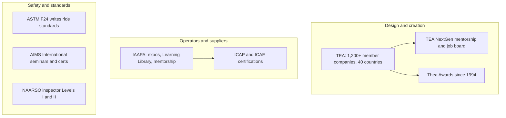

Three clusters of associations run the professional side. The Themed Entertainment Association (TEA), founded by Monty Lunde, represents the people who design and build experiences: more than 1,200 member companies in 40 countries. Student membership is cheap and opens the NextGen mentorship, the job board and the Thea Awards, first given in 1994.

IAAPA, the International Association of Amusement Parks and Attractions, represents operators and suppliers and runs the expos in Orlando, London, Osaka and Abu Dhabi. For careers it offers two credentials: the IAAPA Certified Attractions Professional (ICAP) and the IAAPA Certified Attractions Executive (ICAE), each requiring an exam and 40 hours of continuing education every three years. It shapes the [industry structure](../operations-business/industry-structure.md) that designers sell into.

The safety bodies are smaller. [ASTM F24](../safety-standards/astm-f24.md) is the committee that writes the ride standards, and practitioners can join it. AIMS International runs the January safety seminar and certifies ride inspectors, maintenance technicians and operations technicians. NAARSO, founded in 1987, offers Level I and II inspector certification and its own seminar; both feed the [inspections](../safety-standards/inspections.md) regime and the broader [safety culture](../safety-standards/safety-culture.md).

Join TEA first if you design, IAAPA first if you operate, and a safety body as soon as you touch rides.

## Explore further
- `tea-about` — About TEA
- `iaapa-certification` — IAAPA Certifications: ICAP and ICAE
- `aims-international` — AIMS International
- `naarso` — NAARSO
