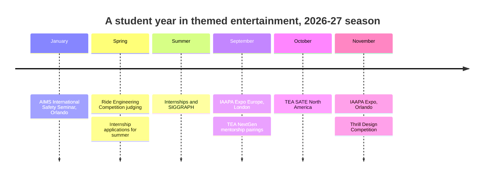

Themed entertainment is a small industry that recruits through its own community. Five kinds of programme matter. [University programs](../careers/university-programs.md) now include dedicated degrees in themed design and attraction management. [Competitions](../careers/competitions.md) such as Imaginations and the Ride Engineering Competition are the industry's talent scouts. [Conferences](../careers/conferences.md) are where the work is shown and the hiring conversations happen. [Professional bodies](../careers/professional-bodies.md), chiefly TEA and IAAPA, run the mentorship, job boards and certifications. [Internships and entry paths](../careers/entry-paths.md) are how the first job actually arrives.

TEA NextGen is the hub for newcomers: a six-month one-to-one mentorship, speed networking, webinars, behind-the-scenes tours and low-cost entry to signature events, backed by partners including Walt Disney Imagineering, Universal Creative and Wētā Workshop. IAAPA runs its own mentorship programme and a Learning Library of recorded sessions. AIMS International's January seminar is the safety-side equivalent, with more than 400 hours of content.

The thread running through all of it is relationships. Projects are staffed through [cross-discipline collaboration](../design-process/cross-discipline-collaboration.md) between people who met at these events, and the industry's [safety culture](../safety-standards/safety-culture.md) is passed on the same way.

## Explore further
- `tea-nextgen` — TEA NextGen
- `iaapa-education` — IAAPA Education
- `aims-international` — AIMS International
