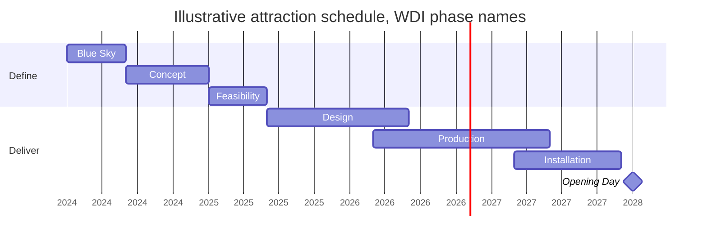

Project and production roles own the question "what will it take to make it real?" Imagineering's own process lists seven phases, Blue Sky, Concept, Feasibility, Design, Production, Installation and Opening Day, and these roles carry a project through all of them. Typical titles are project manager, show producer or producer, project planner and scheduler, estimator, construction manager, procurement specialist and BIM or document controller. Universal Creative's Facilities & Construction area lists project management, facility design, area development, scheduling and estimating; a recent WDI posting was a Senior Project Planner/Scheduler in London.

What they make: the [phase timeline](../design-process/phase-timeline.md), [capital budgets](../operations-business/capital-budgets.md), scope documents, risk registers, contracts and change orders. They run the [design reviews and gates](../design-process/design-reviews-and-gates.md) where creative wants meet cost, and lead [scope and value engineering](../design-process/scope-and-value-engineering.md) when the two collide. During [site construction](../design-process/site-construction.md) they coordinate dozens of vendors across several countries.

Tools are scheduling software, cost databases, BIM models and plenty of spreadsheets. Preparation is usually construction management, architecture, engineering or business, often with a project-management credential, plus time inside a design studio to learn why the creative side fights for details.

## Explore further
- `wdi-our-process` — Walt Disney Imagineering — Our Process
- `universal-creative-careers` — Universal Creative — Careers
- `disney-careers-imagineering-jobs` — Disney Careers — WDI job listings
