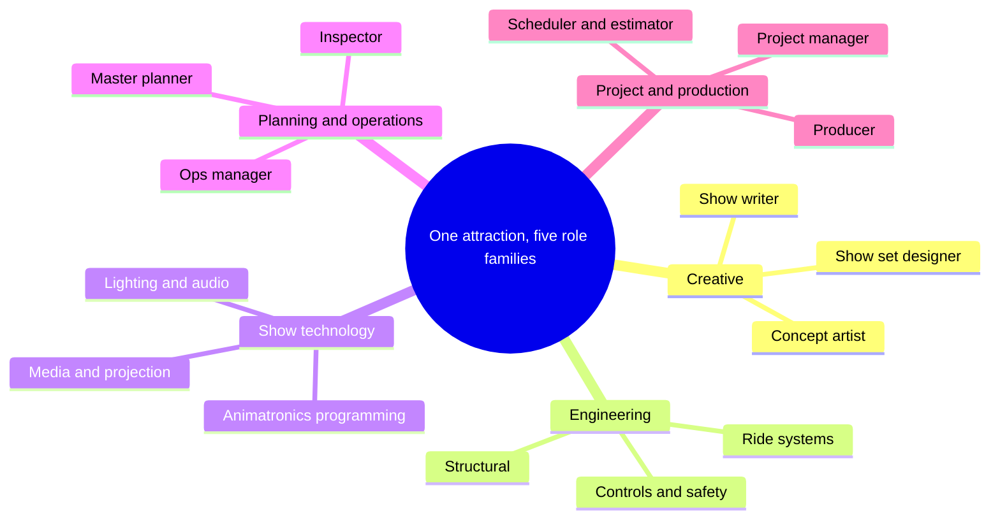

No single person designs a theme park ride. Walt Disney Imagineering says it employs more than 100 disciplines, from artists and architects to model makers and mathematicians. Universal Creative sorts its openings into five areas: Creative Studio, Engineering & Safety, Facilities & Construction, Administration, and Internships. This land uses a similar five-family map.

The families work in sequence and in parallel. Creative roles set the story and the look. Engineering roles make the vehicle move safely. Show technology roles make the scenes perform on cue. Planning and operations roles make sure guests can get in, through and out. Project and production roles hold the budget, schedule and scope together. The handoffs between them are where most of the craft lives, which is why [cross-discipline collaboration](../design-process/cross-discipline-collaboration.md) and the [pipeline overview](../design-process/pipeline-overview.md) are worth reading alongside each role card.

A useful hybrid is the [show producer](../design-process/show-producer.md), who translates between creative and technical teams. Universal's version of all this is covered under [Universal Creative](../history/universal-creative.md). Before choosing a lane, look at the [skills](../careers/skills.md) cards: most roles share drawing, communication and systems thinking.

## Explore further
- `wdi-careers` — Walt Disney Imagineering — Careers
- `universal-creative-careers` — Universal Creative — Careers
