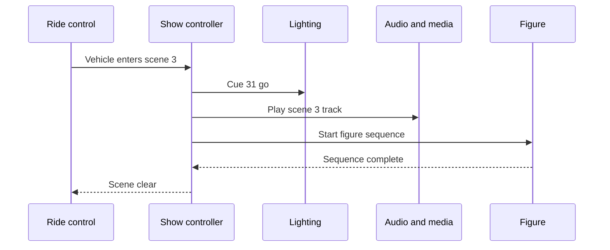

Show technology roles sit between the ride and the story. When a vehicle trips a sensor, someone has to have decided which lights, sounds, projections, effects and animatronic moves happen next, and someone has to keep them running every day. Typical titles are show control engineer or programmer, audio-visual engineer, lighting designer, sound designer, media or projection engineer, special effects designer, animatronics or figure programmer, and show systems integrator.

What they make: cue lists, control logic, network and signal diagrams, projection alignment maps and the figure animations described in [figure programming](../show-technology/figure-programming.md). Their core problem is [ride-show synchronization](../show-technology/ride-show-synchronization.md), managed through [show control systems](../show-technology/show-control-systems.md).

Tools come from theatre and live events: QLab for cue-based playback, Vectorworks Spotlight for lighting and rigging drawings, lighting consoles, media servers and real-time engines, and PLC or show-controller programming. The usual path in is live entertainment, from theatre tech and concert touring to themed attractions. Falcon's Creative Group's Clint Gove, a senior controls engineer, got his role by asking people he knew about openings. Expect to spend nights on site during [show install](../design-process/show-install.md), when [theatrical lighting](../show-technology/theatrical-lighting.md) and audio are finally tuned in the real space.

## Explore further
- `universal-creative-careers` — Universal Creative — Careers
- `qlab` — QLab
- `vectorworks-spotlight` — Vectorworks Spotlight
- `falcons-foot-in-the-door` — How to Get Your Foot in the Door at a Theme Park Design Company
