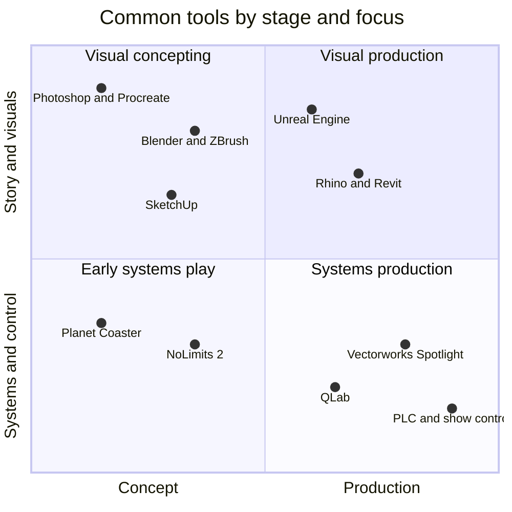

No single program defines the industry, but the clusters are stable. Creative roles paint in Photoshop or Procreate and model in Blender, ZBrush and Unreal Engine; Laguna College of Art + Design lists exactly those three as the core 3D tools of its themed design track. Show set designers and architects move to Rhino, SketchUp and Revit for drawings that contractors can build from, which is where [schematic design](../design-process/schematic-design.md) lives.

Engineers use parametric CAD, finite-element analysis and PLC programming. Show technology roles use QLab for cue playback, Vectorworks Spotlight for lighting and rigging plans, lighting consoles and [media servers and real-time engines](../show-technology/media-servers-and-real-time-engines.md). Unreal Engine now crosses lanes: it drives [previs](../design-process/previs.md), [VR design review](../design-process/vr-design-review.md) and on-ride media.

For learning, start cheap. Blender is free and open source. NoLimits 2 is a realistic coaster simulator that even carries a licensed Vekoma track style and an endorsement from designer John Wardley; it teaches [ride layout](../design-process/ride-layout-design.md) intuition faster than any textbook. Planet Coaster is a game, but it is a fine sketchpad for land composition. Remember Don Carson's point: tools change, drawing stays, so treat software as a way to communicate a decision, not as the skill itself.

## Explore further
- `lcad-themed-design-track` — LCAD Themed Design track
- `nolimits-2` — NoLimits 2
- `qlab` — QLab
- `rhino3d` — Rhinoceros 3D
