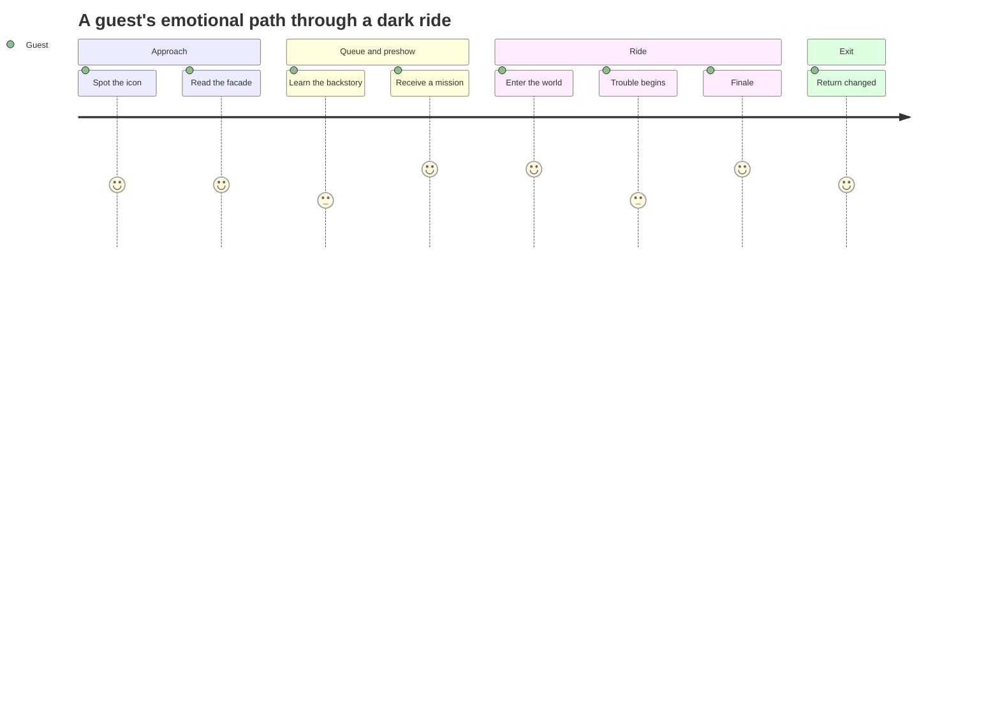

In themed entertainment, story is not decoration added after the ride is designed; it is the reason each decision exists. John Hench, who spent decades at Disney, framed the parks as "the art of the show", where colour, scale and sightline all serve a narrative the guest feels rather than reads. Designers from engineering or architecture backgrounds need enough story craft to make those calls.

Practically, that means learning three documents. The [story bible](../story-experience/story-bible.md) answers who, where and when. The [ride beat sheet](../story-experience/ride-beat-sheet.md) maps emotion to the vehicle's position, scene by scene. [Show scripts](../story-experience/show-scripts.md) and signage carry the voice. The link between them is [environmental storytelling](../story-experience/environmental-storytelling.md): guests infer plot from props, wear and architecture, so every physical object is a sentence.

A good free syllabus is Imagineering in a Box, whose three lessons move from world-building to attraction design to characters, ending with a design-your-own project. Practise by writing a one-line premise, the guest's role, and three acts for an existing ride, then compare with the real thing. Writers do have a dedicated role: former Imagineer Brian Collins wrote jokes for the Jungle Cruise, and show writers sit alongside artists from the first [design intent](../design-process/design-intent.md) meeting.

## Explore further
- `hench-designing-disney` — Designing Disney: Imagineering and the Art of the Show
- `khan-imagineering-in-a-box` — Imagineering in a Box
- `clickorlando-brian-collins` — Retired Disney Imagineer shares his top secrets
