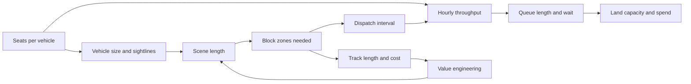

A theme park attraction is a system of loops. Add two seats to a vehicle and the ride needs wider sightlines and larger scenes, which lengthen the track, which adds [block zones](../ride-engineering/block-system.md), which changes the dispatch interval, which changes [throughput](../operations-business/throughput-math.md), which changes queue size and how many guests the land can hold. Systems thinking is chasing those arrows before a decision, not after.

The Imagineering process is built around this. Its Feasibility phase exists to ask what the idea will take, balancing creative goals against planning, cost and physical constraints, and its Design phase cross-checks every component across disciplines. [Scope and value engineering](../design-process/scope-and-value-engineering.md) is systems thinking under budget pressure: cutting a scene saves money but may break pacing and the finale.

To practise, pick any ride and trace one loop end to end. Start at [capacity planning](../masterplanning/capacity-planning.md), follow it to vehicle and track, then to show systems and staffing. Steve Alcorn's engineer's-eye book and David Younger's interview-based reference both show how experienced designers hold these couplings in their heads. The payoff is credibility in [cross-discipline collaboration](../design-process/cross-discipline-collaboration.md): you can explain to a writer why a scene is thirty seconds long, and to an engineer why those thirty seconds matter.

## Explore further
- `younger-theme-park-design` — Theme Park Design and the Art of Themed Entertainment
- `wdi-our-process` — Walt Disney Imagineering — Our Process
- `alcorn-theme-park-design-engineer` — Theme Park Design: Behind the Scenes with an Engineer
