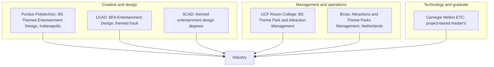

Dedicated theme park degrees now exist, split by lane. For management, UCF's Rosen College in Orlando launched a BS in Theme Park and Attraction Management in Fall 2023, grown from a 2001 track and a 2020 certificate. In Europe, Breda University of Applied Sciences runs the Attractions & Theme Parks Management track, taught in English, with Europa-Park as a fifteen-year partner.

For design, Purdue Polytechnic offers a Themed Entertainment Design major in Indianapolis that blends animation, game design and interactive media, plus a minor and an online certificate. Laguna College of Art + Design has a themed track inside its entertainment design BFA. Savannah College of Art and Design also offers themed entertainment design degrees; its pages could not be verified for this card, hence the medium confidence.

For technology, Carnegie Mellon's Entertainment Technology Center, founded in 1999 by Randy Pausch and Don Marinelli, runs a four-semester project-based master's that feeds [real-time engine](../ai-future/real-time-engines.md) and interactive roles.

Most engineers, architects and writers still arrive through standard degrees, then specialise. Whatever the route, pick a programme with live client projects: [cross-discipline collaboration](../design-process/cross-discipline-collaboration.md) and [park operations](../operations-business/park-operations.md) exposure are what employers screen for, and they feed directly into [entry paths](../careers/entry-paths.md).

## Explore further
- `ucf-theme-park-degree-launch` — UCF Theme Park and Attraction Management degree
- `buas-atpm` — Attractions & Theme Parks Management, BUas
- `purdue-themed-entertainment-design` — Purdue Themed Entertainment Design
- `cmu-etc-about` — About the CMU Entertainment Technology Center
