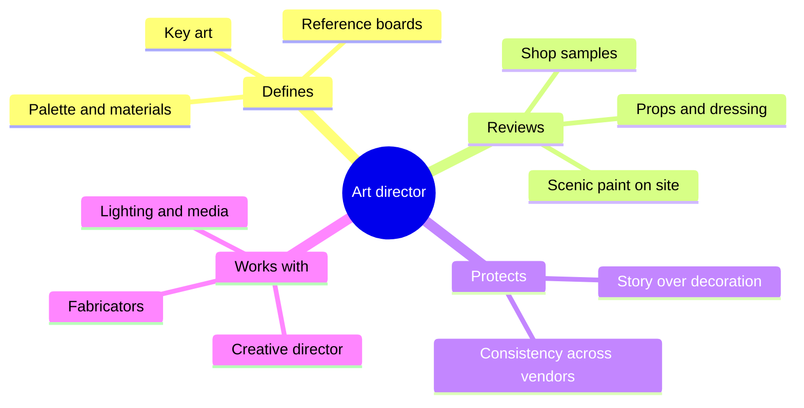

The art director owns the look. Not the story, which belongs to the creative director and writers, and not the money, which belongs to the producer, but the thousand visual decisions that make a place feel like one hand made it. Thinkwell's senior art director Chuck Roberts describes the job as overseeing and collaborating in every phase, from early theatrical concepts and design notes through production and installation. Kate Rogers of Pico Play sums up her process as research, testing and prototyping, hands-on from the first model to construction trials.

In practice that means setting the palette and material language, approving every sample a fabricator sends, and standing on a lift at midnight telling a scenic painter the rust is too orange. On VelociCoaster the art director led the design of the train itself, deciding on lap bars and how the vehicle read as a vehicle. Art direction is what keeps [scenic painting](../design-process/scenic-painting.md), [props](../story-experience/set-dressing-and-props.md) and [colour scripts](../sensory-environment/color-scripts.md) from drifting apart when five vendors are working at once, and it is the discipline that most clearly separates [theme from decoration](../story-experience/theme-vs-decoration.md). It is one of the core [creative roles](../careers/creative-roles.md) in the industry.

## Explore further
- `blooloop-chuck-roberts` — Chuck Roberts, Senior Art Director, Thinkwell Group (Blooloop influencer profile)
- `blooloop-pico-play-kate-rogers` — Pico Play welcomes Kate Rogers as senior art director
- `blooloop-velocicoaster-design` — Universal Orlando's new VelociCoaster: more teeth, more thrills
