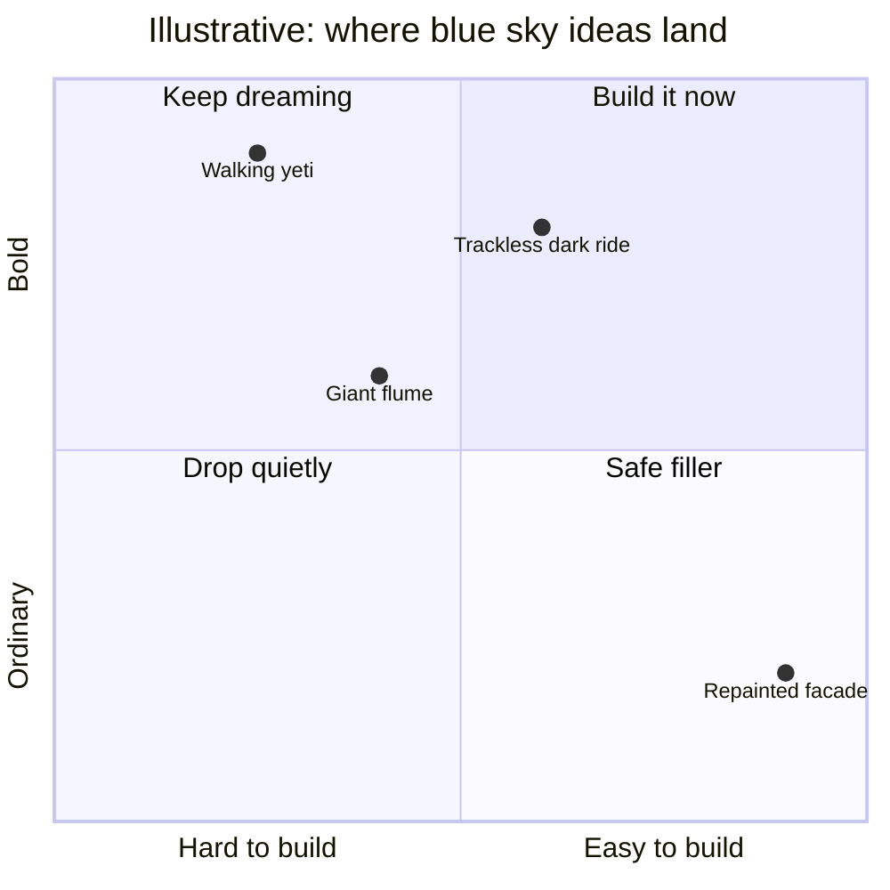

Blue sky is the stage where a team is told to ignore cost, site and technology and simply ask what would be amazing. Imagineering made the term famous: a bold idea may be developed in detail while budget and physics are parked for later. The point is not that limits do not exist. It is that limits applied too early produce ordinary work. Bold ideas can be scaled down; timid ideas cannot be scaled up.

In practice blue sky is a workshop, often called a charrette, where writers, artists and engineers sketch together for a day or two. The Themed Entertainment Association has run the same exercise as a conference session. Good blue sky still answers a story question, which is why it feeds straight into [story-driven design](../story-experience/story-driven-design.md) and the [story bible](../story-experience/story-bible.md). Its natural enemy is [value engineering](../design-process/scope-and-value-engineering.md), and the tension between them shapes the whole [pipeline](../design-process/pipeline-overview.md). Generative tools now promise faster [concepting](../ai-future/generative-concepting.md), but the brief still has to come from people.

## Explore further
- `wikipedia-walt-disney-imagineering` — Walt Disney Imagineering (Wikipedia)
- `khan-imagineering-in-a-box` — Imagineering in a Box (Khan Academy x Walt Disney Imagineering)
- `blooloop-sate-2009-blue-sky` — Themed Entertainment: Blue Sky Adventure at TEA's SATE Conference
