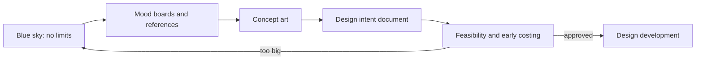

The concept phase is where an attraction is only an idea. Nothing is drawn to scale yet. The team asks what the story is, what guests will feel, and whether anyone can afford it. Imagineering calls the first step [blue sky](../design-process/blue-sky.md): ideas are allowed to run without a budget. Then the idea is given a look through [mood boards](../design-process/mood-boards.md) and [concept art](../design-process/concept-art.md), and a voice through a [story bible](../story-experience/story-bible.md).

The phase ends when two documents exist. One is a [design intent](../design-process/design-intent.md) package that says what the thing is. The other is a rough cost and feasibility check. Together they let a studio decide whether the idea fits the park's [attraction mix](../masterplanning/attraction-mix.md) and its [capital budget](../operations-business/capital-budgets.md). Most ideas stop here, and that is the point: killing an idea on paper is cheap, killing it in concrete is not.

## Explore further
- `khan-imagineering-in-a-box` — Imagineering in a Box (Khan Academy x Walt Disney Imagineering)
- `imagineers-behind-the-dreams` — Walt Disney Imagineering: A Behind the Dreams Look at Making the Magic Real
- `wikipedia-walt-disney-imagineering` — Walt Disney Imagineering (Wikipedia)
