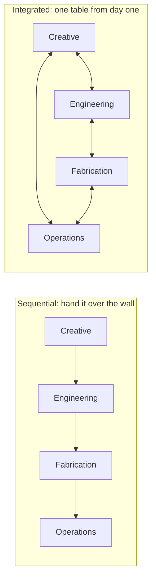

An attraction is a building, a machine, a theatre show and a small business, all occupying the same cubic metres. No single discipline can design it. The old failure mode is sequential: artists dream, engineers say no, fabricators compromise, operators inherit the result. The better pattern puts everyone at one table early, while changes are still cheap.

Universal Creative's Hagrid's team describe exactly that: creative, engineering and facilities people who did not work in silos, which is how a multi-launch coaster full of animated figures was delivered on a compressed schedule. Imagineering's Shanghai castle needed roughly 142 disciplines across two continents, and a written diagram of who owned which data. Imagineering in a Box teaches the same lesson to students by asking them to balance beat sheets and models against throughput and footprint in one exercise. Collaboration is what makes [ride and show synchronisation](../show-technology/ride-show-synchronization.md) possible, what a clean [engineering handoff](../design-process/engineering-handoff.md) depends on, and what several [design oversight incidents](../safety-standards/design-oversight-cases.md) were missing. It is a skill, close to [systems thinking](../careers/systems-thinking.md), and designers who can explain a story to an engineer are worth more than those who cannot.

## Explore further
- `themeparkinsider-hagrids-universal-creative` — How Universal Creative Brought Hagrid's Magic to Life
- `designworld-disney-bim-shanghai-castle` — How BIM Helped Disney Build Its Most Complex Creation Ever
- `khan-imagineering-in-a-box` — Imagineering in a Box (Khan Academy x Walt Disney Imagineering)
