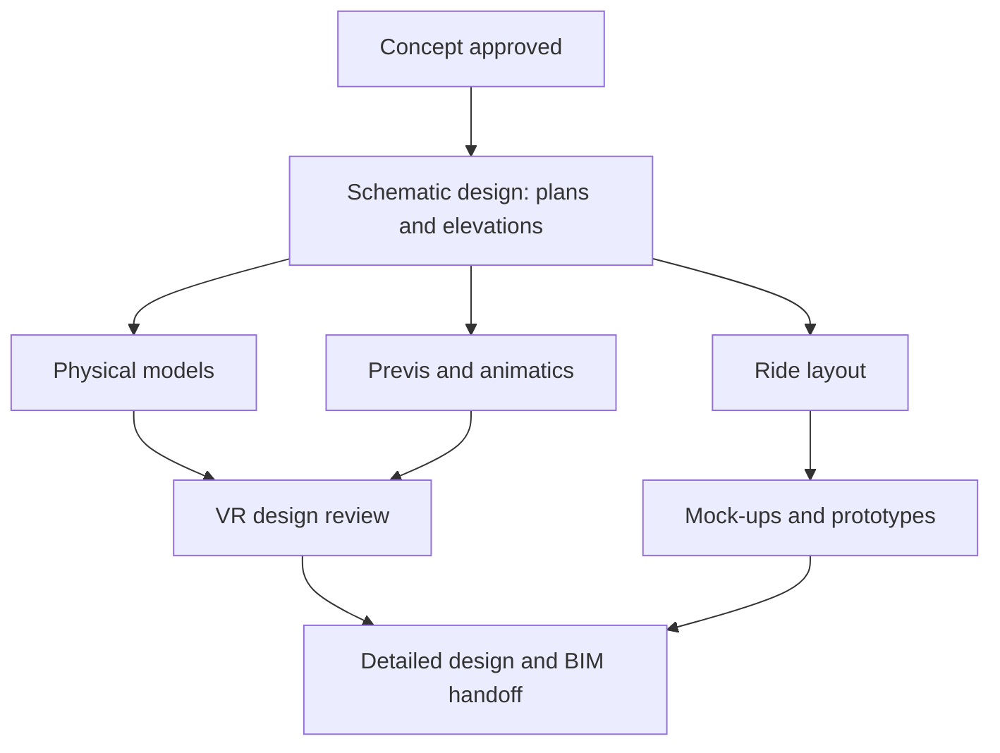

Design development turns a feeling into a set of facts. The concept said "a mine train through a haunted mountain"; this phase says how long the track is, where the show building sits, how tall the mountain must be to hide it, and what each scene costs. Themed architecture firms describe the work as refining the schematic into fully dimensioned drawings with colours chosen and creative intent locked.

The tools are the interesting part. Teams still build [physical models](../design-process/models-and-maquettes.md), but they also ride the attraction early through [previs](../design-process/previs.md) animatics and walk it in [VR review rooms](../design-process/vr-design-review.md). [Ride layout](../design-process/ride-layout-design.md) is tuned against [track geometry](../ride-engineering/track-geometry.md) and the [throughput](../operations-business/throughput-math.md) the park needs. Cheap [mock-ups](../design-process/mockups-and-prototypes.md) answer questions about reach, fit and sightlines before anything is welded. The phase ends with a coordinated BIM model handed to engineers and contractors. Everything after this costs ten times more to change, so the goal is to make the mistakes here.

## Explore further
- `paprojects-expertise-phases` — P+A Projects: Architectural Design, Engineering and Modeling expertise
- `khan-imagineering-in-a-box` — Imagineering in a Box (Khan Academy x Walt Disney Imagineering)
- `blooloop-velocicoaster-design` — Universal Orlando's new VelociCoaster: more teeth, more thrills
