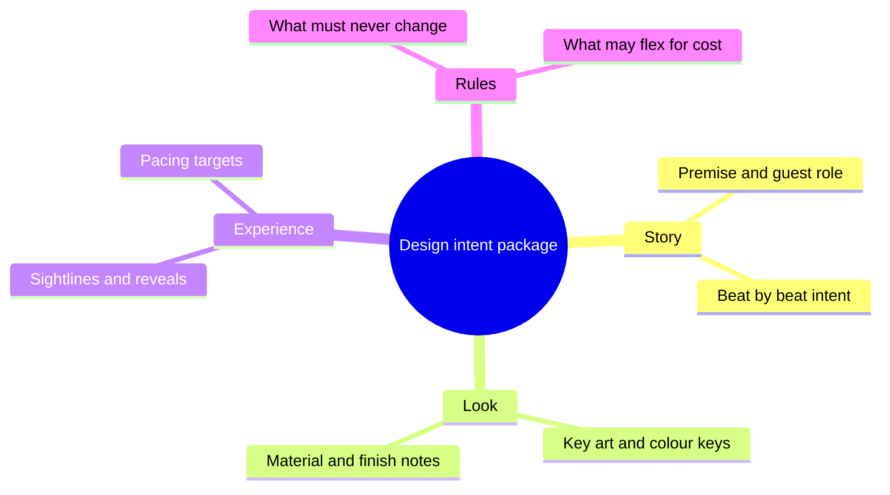

A design intent document says, in words and pictures, what the attraction is supposed to be. It is the bridge between a painting and a drawing set. Where a [story bible](../story-experience/story-bible.md) explains the fiction, design intent explains the decisions: this corridor is dark so the reveal lands, this facade is stone not paint because guests will touch it. Themed architecture firms describe the moment when plans, specifications and creative intent are all locked as the end of detailed design.

The document earns its keep later. Engineers, contractors and fabricators who never met the concept team read it to understand why a detail matters, which is the whole problem of [engineering handoff](../design-process/engineering-handoff.md). It also protects the show during [value engineering](../design-process/scope-and-value-engineering.md), because it separates what is [theme from what is decoration](../story-experience/theme-vs-decoration.md). Art directors describe their job as collaborating in every phase from first concept to installation; the intent document is how that voice travels when they are not in the room. Formats vary by studio and few are public; BRC Imagination Arts only wrote its forty-year method down in a 2026 book, so treat the structure above as typical rather than standard.

## Explore further
- `paprojects-expertise-phases` — P+A Projects: Architectural Design, Engineering and Modeling expertise
- `blooloop-chuck-roberts` — Chuck Roberts, Senior Art Director, Thinkwell Group (Blooloop influencer profile)
- `khan-imagineering-in-a-box` — Imagineering in a Box (Khan Academy x Walt Disney Imagineering)
- `blooloop-brc-deep-story` — BRC Imagination Arts celebrates launch of Bob Rogers' book, Deep Story
