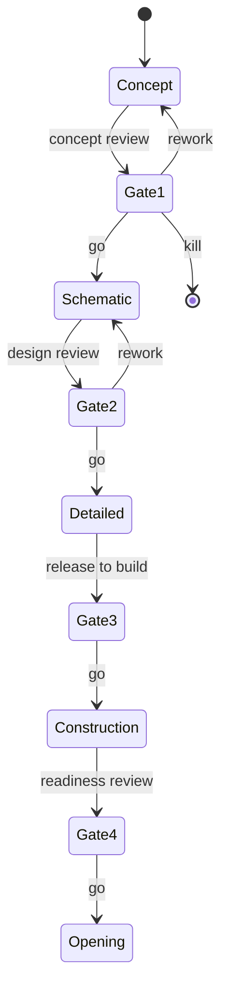

Big projects are run as a series of bets, and gates are where the bet is re-examined. A phase-gate process divides the work into stages separated by decision points. At each gate a leadership group looks at the business case, the risks and the money spent so far, then says go, kill, or go back and fix it. Gates use hard "must meet" criteria and softer scored ones. The model is widely used in product development and in large engineering programmes such as NASA's phased reviews.

In attraction design the gates line up with the phases: concept approval, schematic sign-off, release to detailed design, release to fabrication, and operational readiness. A design review at each gate checks the work against requirements, ideally with at least one reviewer from outside the team, and catches problems while they are still drawings. Safety reviews run alongside, feeding the formal [risk assessment](../safety-standards/risk-assessment.md) that standards such as [ASTM F2291](../safety-standards/astm-f2291.md) expect. Gates are also the honest place to [value engineer](../design-process/scope-and-value-engineering.md) rather than at the end, and they give the [capital budget](../operations-business/capital-budgets.md) its release points. The cost of a gate is time; the cost of skipping one is a change order in concrete.

## Explore further
- `wikipedia-phase-gate` — Phase-gate process (Wikipedia)
- `wikipedia-design-review` — Design review (Wikipedia)
- `iaapa-funworld-busted-budgets` — Avoiding Busted Budgets (IAAPA Funworld)
