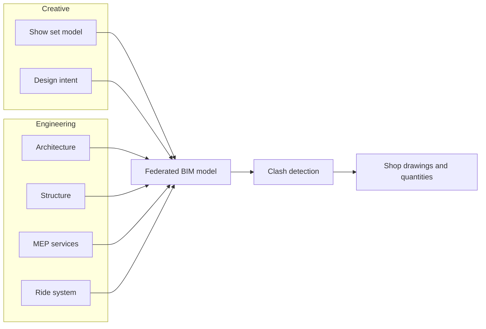

Handoff is where most of the money gets committed and most of the intent gets lost. Building information modelling, or BIM, is the industry's answer: one shared digital model that carries geometry plus data for every discipline, so architects, structural engineers, services engineers and the ride supplier design in the same space. Software then runs clash detection, catching the duct that passes through the dragon before anyone builds either.

Walt Disney Imagineering's Shanghai castle is the public case study. Architects worked in Revit while structural and services teams stayed in AutoCAD, so WDI wrote scripts that pushed architectural data to the others daily and drew a diagram of who owned which information. Object attributes gave exact concrete quantities and flame-spread data, and the workflow won a 2014 AIA award. Expedition Everest shows the physical stakes: the mountain, coaster and yeti are three independent structures reaching the ground without touching, coordinated with 4D scheduling. Good handoff protects [foundations](../ride-engineering/supports-and-foundations.md), [utilities](../masterplanning/utilities-and-central-plant.md) and the [ride control](../safety-standards/ride-control-systems.md) interfaces, and the model later becomes the seed of a [digital twin](../ai-future/digital-twins.md).

## Explore further
- `designworld-disney-bim-shanghai-castle` — How BIM Helped Disney Build Its Most Complex Creation Ever
- `wikipedia-bim` — Building information modeling (Wikipedia)
- `wikipedia-expedition-everest` — Expedition Everest (Wikipedia)
