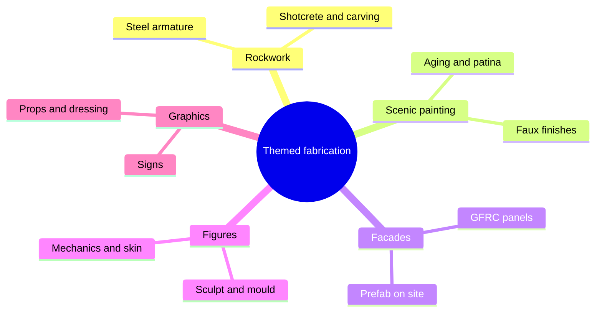

Fabrication is the moment a drawing becomes something you can touch. Themed environments are built by specialist contractors rather than ordinary builders: companies such as Nassal and Scenario in Orlando, Garner Holt for figures, and until recently Cinnabar in Los Angeles, whose work ran from film sets to museum exhibits. Their shops combine welders, sculptors, scenic painters, mould makers and electricians under one roof, which is unusual in construction and essential here.

The five crafts in this group each have their own card. [Rockwork](../design-process/rockwork.md) builds mountains from steel, lath and sprayed concrete. [Scenic painting](../design-process/scenic-painting.md) makes new surfaces read as old. [Themed facades](../design-process/themed-facades.md) hang light GFRC skins on plain buildings. [Figure fabrication](../design-process/figure-fabrication.md) turns a sculpt into a moving character. [Signage and graphics](../design-process/signage-and-graphics.md) finish the world with words. Increasingly the work is prefabricated off site, where weather, space and congestion cannot touch quality, then shipped and bolted down. Digital tools now mill foam and bend rebar from models, but the final texture that guests see and touch is still cut by hand.

## Explore further
- `blooloop-scenario-rebrand` — Becoming Scenario: more than rockwork
- `iaapa-marketplace-nassal` — The Nassal Company (IAAPA Marketplace)
- `blooloop-cinnabar-legacy` — Cinnabar: crafting a legacy of creativity, collaboration and innovation
- `blooloop-pico-play-fabrication` — Pico Play's fabrication facility is in demand across the globe
