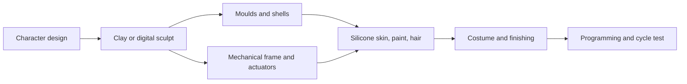

A figure starts as a sculpture and ends as a machine wearing one. Builders such as Garner Holt Productions, founded in 1977 and credited with thousands of figures, run the whole chain in-house. Sculptors shape the character in clay or digitally; mould makers cast fibreglass shells; machinists build a stainless and aluminium frame with hydraulic, pneumatic or electric actuators for each movement; then skin artists paint silicone that mimics flesh and punch in hair one strand at a time. Costumers and painters finish, and programmers animate.

Disney's Audio-Animatronics history shows how the parts evolved. Early figures were driven by tones on tape closing relays; the DACS system of 1979 to 1981 generated up to a thousand channels of show data from an animator's console; modern controllers allow individually moving fingers and full facial play. Compliance in the mechanics lets limbs overshoot and settle so fast moves do not shake. Silicone skin cracks with flexing and is replaced every five to ten years, which is a maintenance cost designers must budget for. Fabrication choices decide later [actuation](../show-technology/figure-actuation.md), [skin and costume](../show-technology/skin-hair-and-costume.md) upkeep, and how close a face can get to the [uncanny valley](../human-factors/uncanny-valley.md) without falling in.

## Explore further
- `avoidingregret-garner-holt-photo-essay` — Photo Essay: Making Magic Monsters That Move at a Robot Factory
- `blooloop-garner-holt-35-years` — Garner Holt Productions celebrates 35 years of making ideas move
- `wikipedia-audio-animatronics` — Audio-Animatronics (Wikipedia)
