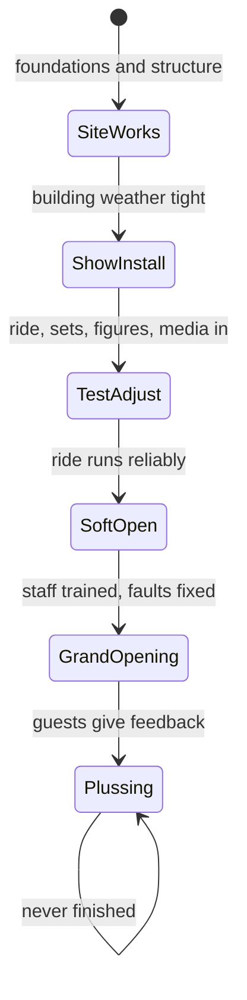

The final phase is where the drawings meet weather, cranes and deadlines. It runs in overlapping steps. [Site construction](../design-process/site-construction.md) pours foundations, raises steel and makes the building weather tight. [Show install](../design-process/show-install.md) then fills it with track, vehicles, sets, figures, lighting and media, and programmers bring each scene to life. [Testing and commissioning](../design-process/testing-and-commissioning.md) runs the whole system for hundreds of hours, first empty, then with water dummies, then with staff, while inspectors sign it off. A [soft opening](../design-process/soft-opening.md) lets real guests ride before the date on the poster, and [post-opening plussing](../design-process/post-opening-plussing.md) keeps improving it afterwards.

Dates show how long this takes. Hagrid's coaster had its first train on the track in December 2018, began ride testing in February 2019 and opened that June. Rise of the Resistance opened fourteen weeks after the rest of its land because the ride was not ready when the streets were. The phase hands the attraction to operations, so [operator training](../safety-standards/operator-training.md), [inspections](../safety-standards/inspections.md) and daily [opening procedures](../operations-business/opening-and-closing-procedures.md) are all born here.

## Explore further
- `wikipedia-hagrids-motorbike-adventure` — Hagrid's Magical Creatures Motorbike Adventure (Wikipedia)
- `wikipedia-rise-of-the-resistance` — Star Wars: Rise of the Resistance (Wikipedia)
- `lvpm-dorney-coaster-testing` — Thrill-seeker safety: Rigorous testing of Dorney's new roller coaster
