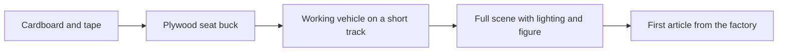

A mock-up is a prototype that is allowed to be ugly. In 2008 a Los Angeles Times writer rode Toy Story Mania at Imagineering's Glendale concept lab in a vehicle of plywood and two-by-fours partly held together with electrical tape. It was enough to test the game, the turn and the sightline to the screens, which was the whole question.

Mock-ups answer body questions. A seat buck checks [ergonomics](../human-factors/ergonomics.md) and [restraint fit](../human-factors/restraint-fit.md) across real people. A reach test defines the [reach envelope](../safety-standards/reach-envelope.md) that clearances will be built to. A single rock sample, from one foot square to seven, is sculpted and painted so the client approves texture before a mountain is carved. Fabricators call these samples and build larger mock-ups in place. Figures and effects are cycle-tested on fixtures because [reliability](../show-technology/figure-reliability.md) is cheaper to find in a shop than in a show building. Universal Creative's Hagrid's team described creative and engineering working together rather than in silos; mock-ups are where that collaboration becomes a shared object everyone can sit in.

## Explore further
- `coasterbuzz-toy-story-mania-mockup` — LA Times blogger gets sneak peek to play Toy Story Mania
- `cost-wisconsin-rockwork-process` — Artificial and Simulated Rockwork: Theme Construction (COST of Wisconsin)
- `themeparkinsider-hagrids-universal-creative` — How Universal Creative Brought Hagrid's Magic to Life
