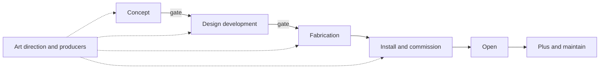

Every card in this land is a piece of one pipeline. An idea is found and pictured in the [concept phase](../design-process/concept-phase.md). It becomes measured drawings, models and tests in [design development](../design-process/design-development.md). Shops turn those drawings into rock, paint and figures in [fabrication](../design-process/fabrication.md). Everything is assembled, tested and previewed in [installation and opening](../design-process/installation-and-opening.md). Running across all of it are the leaders and rituals of [art direction and teams](../design-process/art-direction-and-teams.md).

Two ideas tie the phases together. The first is that cost of change rises steeply: a sketch is free to redraw, a drawing cheap, a mould expensive, a poured wall nearly impossible. Good pipelines push decisions as early as the information allows and no earlier. The second is that money and story negotiate at every gate, which is why [scope and value engineering](../design-process/scope-and-value-engineering.md) has its own card. The [phase timeline](../design-process/phase-timeline.md) shows how long each stage really takes, from a single coaster in under two years to a whole park in six. Imagineering's own book and the Khan Academy course both teach the pipeline in this order, which is a good sign that the order is real.

## Explore further
- `khan-imagineering-in-a-box` — Imagineering in a Box (Khan Academy x Walt Disney Imagineering)
- `imagineers-behind-the-dreams` — Walt Disney Imagineering: A Behind the Dreams Look at Making the Magic Real
- `paprojects-expertise-phases` — P+A Projects: Architectural Design, Engineering and Modeling expertise
- `iaapa-funworld-busted-budgets` — Avoiding Busted Budgets (IAAPA Funworld)
