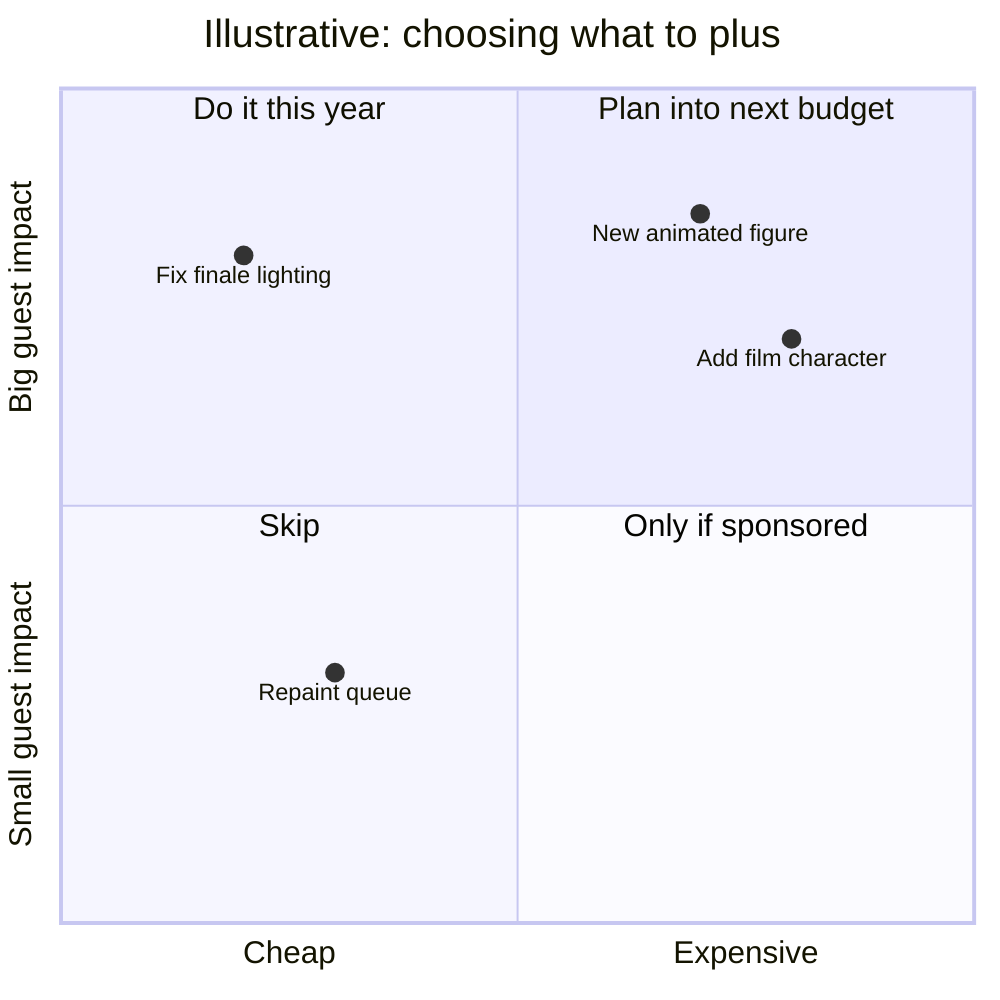

Walt Disney said Disneyland would never be completed as long as there was imagination left in the world, and Imagineers turned that into a verb. Plussing means going back to something that already works and making it better. Past Imagineers list it as the last of their principles, the cardinal rule. In the design pipeline it is the phase that never ends.

Plusses range from tiny to huge. The first weeks after opening are spent fixing timing, lighting and sound that only revealed themselves with crowds. Later, parks add scenes and characters: Pirates of the Caribbean gained film characters in 2006, decades after it opened. Sometimes the plus is a repair that never quite came, as with Expedition Everest's yeti, which has run in a strobe-lit mode since its mechanism was damaged months after opening, with restoration only announced years later. Plussing is the opening move of the [ride lifecycle](../operations-business/ride-lifecycle.md) and the gentle cousin of [retheming](../operations-business/retheming-and-overlays.md). It is guided by [guest research](../operations-business/guest-research.md) and often aimed at the finale, because the [peak-end rule](../human-factors/peak-end-rule.md) says the last minute is what guests will remember.

## Explore further
- `wikipedia-walt-disney-imagineering` — Walt Disney Imagineering (Wikipedia)
- `wikipedia-audio-animatronics` — Audio-Animatronics (Wikipedia)
- `wikipedia-expedition-everest` — Expedition Everest (Wikipedia)
