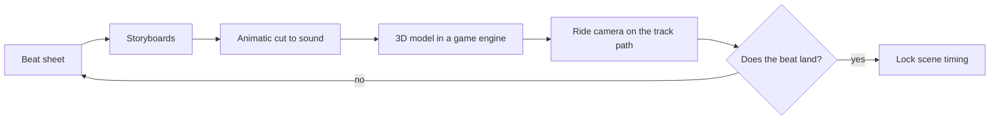

Previsualization, or previs, is borrowed from film. Walt Disney's studio cut storyboards to a soundtrack as a "Leica reel"; modern productions block whole sequences in 3D before shooting. Ride designers do the same thing with the one camera that matters: the guest's seat. A model of the show building goes into a real-time engine, a camera is driven along the track at the planned speed, and the team watches whether each beat of the [beat sheet](../story-experience/ride-beat-sheet.md) arrives on time.

Don Carson of The Hettema Group has shown a physical model being scanned, rebuilt in SketchUp and ridden with a real-time camera to test timing. Fabled Creative pipes Cinema4D and Revit models into Unreal Engine for client walkthroughs. On VelociCoaster the show producer says the team moved quickly into animatics, and the concept teaser was built from them years later. Previs is where [pacing](../story-experience/pacing-and-structure.md) is argued and fixed, and the same engines increasingly drive the finished [media servers](../show-technology/media-servers-and-real-time-engines.md) on the ride itself.

## Explore further
- `wikipedia-previsualization` — Previsualization (Wikipedia)
- `enscape-hettema-previs-webinar` — The Hettema Group: Revolutionizing the Theme Park Design Process (webinar)
- `blooloop-fabled-creative-unreal` — Fabled Creative uses Unreal Engine to revolutionise themed attraction design work
- `blooloop-velocicoaster-design` — Universal Orlando's new VelociCoaster: more teeth, more thrills
