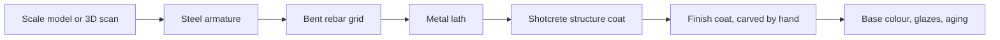

Themed rockwork is sculpture at the scale of a building. The process is consistent across fabricators. A physical model or 3D scan is approved first. Welders build a steel armature to that shape, then bend and tie a grid of rebar over it. Metal lath is wired to the rebar, and concrete is sprayed on as shotcrete to a set thickness. While the finish coat is still soft, artisans carve strata, cracks and texture by hand, matching an approved sample panel. Painters finish with a base tone, layered glazes and a final aging wash.

Expedition Everest's mountain stands 199.5 feet, just under the height that would require an aircraft warning light, and it is a separate structure from the coaster and the yeti inside it. Pandora's floating mountains rise 156 feet on steel beams that rockwork and vines hide completely, a trick that depends on [forced perspective](../story-experience/forced-perspective.md). Disney has patented a system that turns a 3D rock mesh into numbered rebar pieces so the frame can be assembled rather than improvised, a live example of the [craft versus automation](../ai-future/craft-vs-automation.md) question. Rockwork also does quiet jobs: it makes the most convincing [berm](../story-experience/the-berm.md) and the most natural [weenie](../story-experience/weenies.md).

## Explore further
- `cost-wisconsin-rockwork-process` — Artificial and Simulated Rockwork: Theme Construction (COST of Wisconsin)
- `google-patents-us-11030356` — US11030356B2: Automated system for design and fabrication of artificial rockwork structures
- `wikipedia-expedition-everest` — Expedition Everest (Wikipedia)
- `wikipedia-pandora-world-of-avatar` — Pandora: The World of Avatar (Wikipedia)
